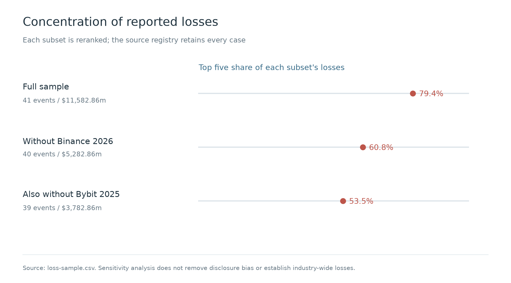
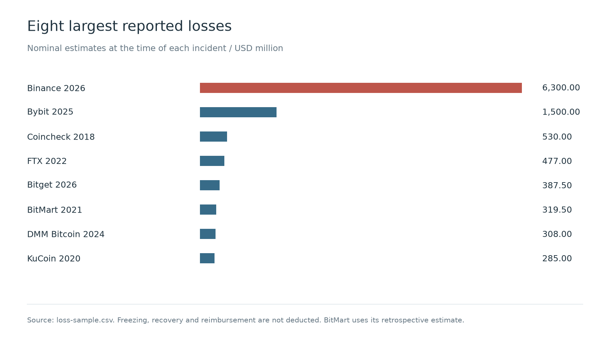
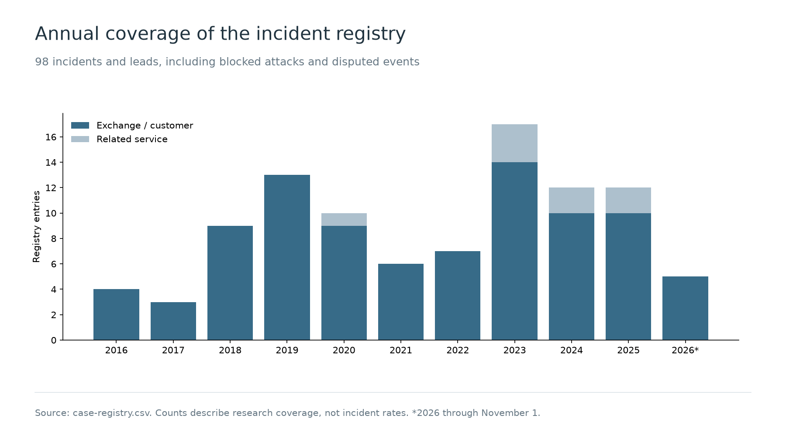

# Methodology and Data

[Repository home](../../README.md) · **English** | [简体中文](../zh-CN/methodology.md)

[Research](research.md) · [Attack paths](attack-paths.md) · [Defense matrix](defense-matrix.md) · [Case catalogue](case-catalogue.md) · **Methodology**

## Scope

The research draws on public material from 2016 through November 1, 2026. It did not involve access to victim networks, private interviews, or exhaustive independent analysis of on-chain transactions.

The registry contains **98 incidents and leads**: 90 involving exchanges or their customers and 8 related services. It retains successful interventions, data incidents, and researcher disputes as well as thefts. Thirty-eight records currently have only incident-index evidence; the nature of the incident or responsibility for it is disputed in five records. Mango Markets and Parity illustrate comparable attack mechanisms outside centralized exchanges and are excluded from the registry and loss sample. UNC1069 is a threat-research profile, not an additional counted loss event.

The 41-event loss sample requires an identifiable loss involving exchange custody or business operations, a dollar estimate supported by more than an index entry, and figures that distinguish the loss from amounts involving other services, response costs, and funds returned. Missing estimates are not zero. The article's 15-case comparison and 12-case attribution/response review are different subsets with different purposes.

The sample overrepresents large and recent incidents, as well as those with detailed English-language disclosures. It cannot establish industry-wide incidence, attack success rates, or the failure probability of a technology. Annual counts describe this registry's coverage, not the number of attacks that actually occurred.

## Monetary values

Amounts use nominal dollar estimates at the time of each incident, without repricing at current token prices or adjusting for inflation. Frozen assets, recovered funds, and reimbursements are not deducted from reported theft. Stablecoin face value is an approximation; the public estimates were not produced under a common audit methodology.

BitMart uses the platform's later retrospective estimate of **$319.5 million**, valued at the time of its December 4, 2021 incident. The commonly reported **$196 million** is retained as an alternative. Nobitex's “more than $90 million” is represented by $90 million as an approximation, not an upper bound. Coinbase's 2025 response/reimbursement costs, combined HTX/HECO figures, and Kraken's disputed research withdrawal are excluded from the monetary sum.

| Calculation | Events | Total, USD million | Median, USD million | Largest share | Top five share |
| --- | ---: | ---: | ---: | ---: | ---: |
| Full loss sample | 41 | 11,582.86 | 45.00 | 54.4% | 79.4% |
| Temporarily omit Binance 2026 | 40 | 5,282.86 | 44.60 | 28.4% | 60.8% |
| Also temporarily omit Bybit 2025 | 39 | 3,782.86 | 44.20 | 14.0% | 53.5% |
| Apply listed alternative estimates | 41 | 11,572.76 | 45.00 | 55.6% | 80.3% |
| Only replace BitMart with $196 million | 41 | 11,459.36 | 45.00 | 55.0% | 80.2% |

The article uses the full sample. Calculations that exclude the largest events show how much the results depend on those events; the source records remain in the dataset, and the smaller totals are not more accurate industry estimates. The top five events are ranked again for each scenario. Alternative estimates test specific known valuation differences. They do not form a confidence interval or cover every source of error.

## Evidence, attribution, and paths

Evidence codes describe source types, not a numerical confidence score:

| Code | Meaning |
| --- | --- |
| P | Primary disclosure, legal/official record, or participant account |
| I | Independent security or blockchain investigation |
| M | Media reporting |
| C | Incident-index entry |

Combined codes retain the available types. An official statement still has its stated limits; a platform assessment is not automatically an independent forensic conclusion. Actor claims, researcher labels, and law-enforcement findings are distinguished in the article. Similar tools or laundering channels alone do not establish a shared operator.

The six paths classify how fund controls fail. Initial access, attacker identity, and downstream consequences are separate descriptions. An incident can follow several paths. Path membership is therefore not an attack-frequency statistic.

## Response observations

Five of the twelve response cases provide seven usable measurements of elapsed time. Time to detect (TTD) starts at an established compromise and ends at detection. If initial compromise is unknown, label the interval from a known event to detection separately. Time to contain (TTC) runs from detection to verified effectiveness of the specified containment measure. Time to recover (TTR) requires an explicit starting point and a defined recovery condition. Mean time to detect (MTTD) and mean time to recover (MTTR) require measurements with comparable scope, start and end events, and timestamp precision.

The measurements include transfer spans, intervals within supplier-side intrusions, a platform-reported upper bound on mitigation time, timeline entries that combine detection and containment, and a recovery-status announcement. They cannot be averaged into one MTTR. Reimbursement, replenishment, freezing, and actual technical recovery remain separate.

## Files and fields

| File | Content |
| --- | --- |
| [case-registry.csv](../../data/case-registry.csv) | Stable case ID, disclosed date, target, scope, evidence types, source identifiers, source URLs |
| [loss-sample.csv](../../data/loss-sample.csv) | Included case ID, date, target, selected loss estimate in millions of USD, amount source ID and URL |
| [alternative-estimates.csv](../../data/alternative-estimates.csv) | Case-specific alternative values for the sensitivity calculation |
| [response-observations.csv](../../data/response-observations.csv) | Seven timing measurements with their definitions and limitations |
| [sources.json](../../data/sources.json) | Research source identifiers mapped to URLs |
| [statistics.json](../../data/statistics.json) | Monetary summaries, annual coverage, evidence counts, and intervals between disclosed events |

Dates are recorded only to the precision given in the source; date ranges are not converted to single timestamps. Registry scope values are `custody_and_business_systems`, `customer_accounts_and_information`, and `related_service`. Multiple source identifiers and URLs are separated by semicolons. Absence from the loss sample means **not included under its selection rules**, not no loss.

Run `python3 scripts/check.py` from the repository root to check local links, bilingual document presence, event identifiers, sample membership, totals, sensitivities, and figure references. The check validates repository consistency; it does not independently authenticate every external source or prove a proposed defense effective.
