# From Bybit to Binance: How Attackers Breach Crypto Exchanges

**English** | [简体中文](../zh-CN/research.md)

**Authors**

Max Luo — AI Security and Automation Lead, Crypto Exchange 
Morgan Chen — AI SOC Platform Lead, Crypto Exchange

> A review of exchange security incidents over the past decade: how attackers entered systems, obtained control over funds, and exploited recurring weaknesses in exchange defenses.

On October 30, 2026, Binance disclosed a security incident involving approximately $6.3 billion in assets. Its initial investigation pointed to a DevOps engineer's laptop: an attacker may have used the compromised endpoint to access a service container and submit unauthorized withdrawals. Binance subsequently reported additional breach points. It had found no evidence of wallet private-key leakage, and the complete attack chain remained undisclosed. The following day, the FBI attributed the attack to North Korea-linked TraderTraitor activity.

Over the past decade, attackers have reached exchange funds through development environments, service providers, and business backends. A tampered transaction display can persuade signers to approve a malicious operation. Altered identity or balance records can cause later withdrawal checks to authorize a payment using false information.

## 1. Binance and Bybit account for 67.3% of sampled losses

### 1.1 Forty-one loss incidents, approximately $11.583 billion

The registry contains 98 records: 90 exchange or customer incidents and 8 related-service incidents. It includes theft, data exposure, successful interventions, and researcher testing. For 38 records, only an incident index has been collected; detailed technical material is unavailable. Mango Markets and Parity illustrate external mechanisms and are excluded from both the registry count and the loss total.

Forty-one incidents have separable estimates of actual asset losses. Values use publicly reported nominal dollar estimates at the time of each incident. Frozen assets, recoveries, and exchange reimbursements are not deducted.

| Sample | Incidents | Total losses | Median loss | Largest incident's share | Top five share |
| --- | ---: | ---: | ---: | ---: | ---: |
| Full monetary sample | 41 | Approximately $11.583 billion | $45 million | 54.4% | 79.4% |

*Calculated from the event-level monetary dataset. The sample favors large, well-disclosed incidents and does not represent the industry's loss distribution. See the [methodology](methodology.md) for value selection and recalculation.*

Under the selected estimates, Binance 2026 accounts for approximately $6.3 billion and Bybit 2025 for $1.5 billion. Together they contribute $7.8 billion, or 67.3% of the 41-incident total. Binance alone accounts for 54.4%.

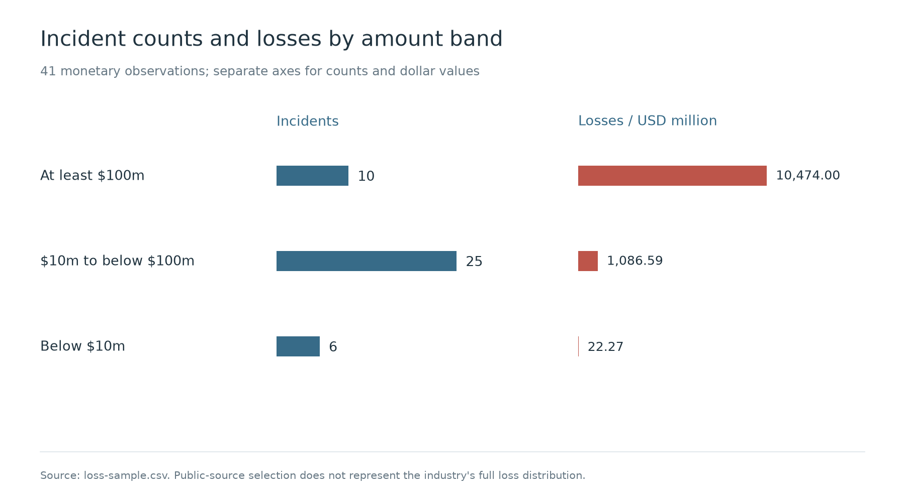

Coinbase's 2025 estimate of $180–400 million covered response costs and voluntary reimbursements. The combined HTX/HECO figure includes a bridge. Kraken's approximately $3 million involved researcher testing and disputed authorization. None of these figures is included in the loss total above.

Attackers may be unable to sell tokens at their incident-time valuation. Execution prices, freezing, and recovery change both criminal proceeds and an exchange's ultimate loss.

## 2. Six principal attack paths

Public cases show several routes to loss. Attackers can transfer assets with stolen private keys, obtain valid signatures for altered transactions, or take over accounts and request withdrawals. Trading and accounting introduce additional routes: abusive trades transfer customer value, inflated collateral values expand borrowing capacity, and erroneous credits can be exchanged or withdrawn.

Some attacks target customers directly. Impersonating support staff or another trusted party, attackers persuade customers to transfer funds or grant authority. Leaked account details make the deception more credible. A customer may authenticate successfully while misunderstanding the recipient or purpose of an operation.

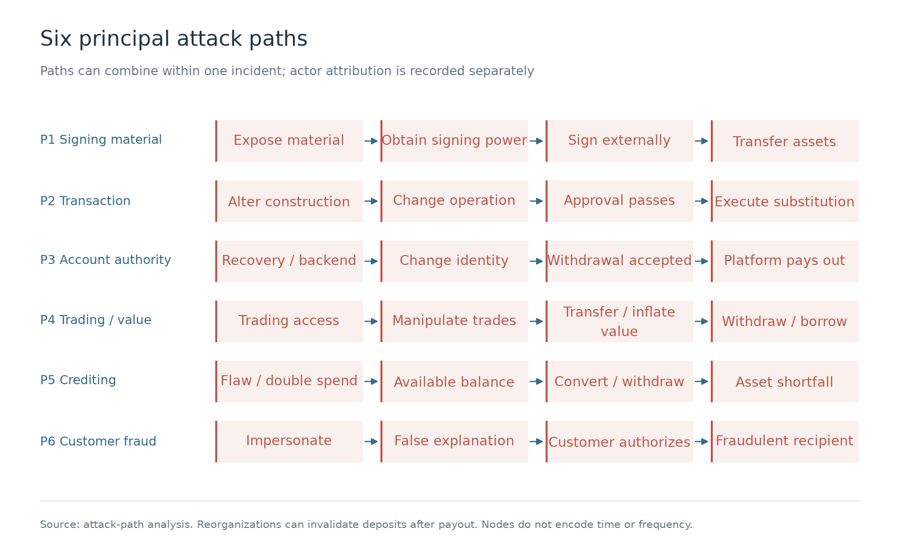

### 2.1 Signing-material compromise

Coincheck's investigation into its 2018 NEM incident inferred that malware infected an employee endpoint, through which the attacker entered the internal network and stole private keys from the NEM server. BitMart also confirmed private-key theft in 2021, but did not fully disclose the initial entry point.

An attacker with sufficient signing material can create transactions in an environment they control. The exchange application's approval checks, limits, and withdrawal suspension may never be invoked. Key generation, storage, use, backup, and recovery can all expose material. Defective signing implementations can also allow private-key recovery from historical public signatures.

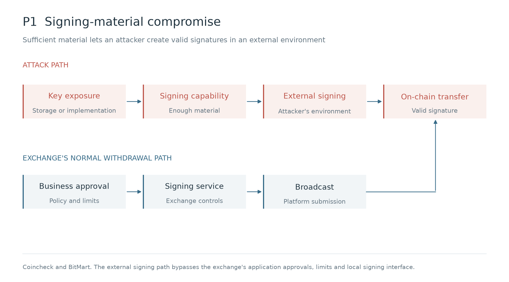

### 2.2 Transaction tampering

In the 2025 Bybit incident, a Safe developer's endpoint was compromised. The attacker obtained cloud access and modified frontend resources. During a cold-wallet transfer, signers interacted with a contaminated transaction interface. The malicious transaction changed the wallet's execution logic; subsequent transfers no longer required the original multisignature approval.

In the SwissBorg/Kiln incident, the attacker used a GitHub token to obtain CI credentials, entered production, and modified a running API. A customer requested unstaking, but the API included a transaction changing withdrawal authority. That transaction was approved within the customer's own custody system. The joint DMM investigation assessed that access to supplier communications was likely used to manipulate a legitimate transaction request.

Transaction checks did not reject the substituted operations. Signers reading the same tampered display may jointly approve a malicious transaction; additional signers do not correct the shared display.

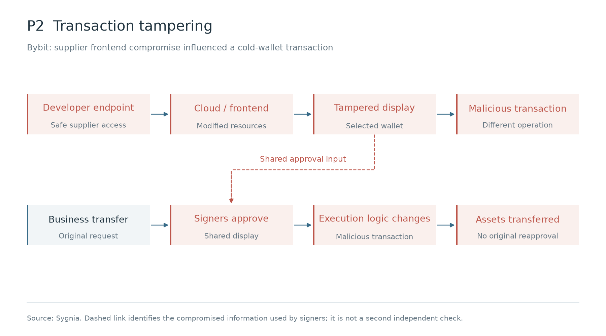

### 2.3 Account and withdrawal-authorization takeover

Coinbase notified at least 6,000 customers of unauthorized transfers in 2021. Attackers already possessed account credentials, phone numbers, and access to email. They then exploited an SMS account-recovery flaw to obtain authentication tokens.

The WOO X attacker moved from a developer endpoint and an existing VPN session through cloud and container environments into backend access. The attacker changed email addresses, passwords, and second-factor seeds for 9 accounts, then requested withdrawals. BigONE described changes to production systems, accounts, and risk-control logic. Bitget's 2026 disclosure stated that a vulnerability in a third-party security product exposed privileged internal credentials that were used to forge withdrawal instructions.

Contract-wallet permissions can also be bypassed. In the 2017 Parity incident, an initialization flaw allowed an attacker to change wallet owners and thresholds without possessing the original owners' private keys.

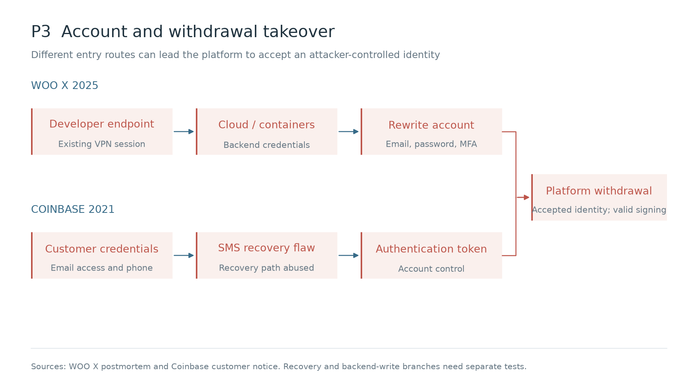

### 2.4 Trading and valuation manipulation

In the 2018 Binance VIA incident, attackers phished user credentials, created APIs, and submitted concentrated market buy orders for VIA. They had prepared 31 accounts to sell at elevated prices. Automatic withdrawal suspension blocked external withdrawals, but some victim orders had traded against uninvolved counterparties. Binance explicitly stated that those trades could not be reversed.

In 2022, 3Commas disclosed exposure of at least 100,000 API records, involving trading credentials stored in an external tool. This counts API records, not victims or monetary losses.

In the 2022 Mango Markets DEX incident, the attacker used their own accounts to establish positions, move a thin market's price, and pledge inflated paper gains as collateral to borrow real assets.

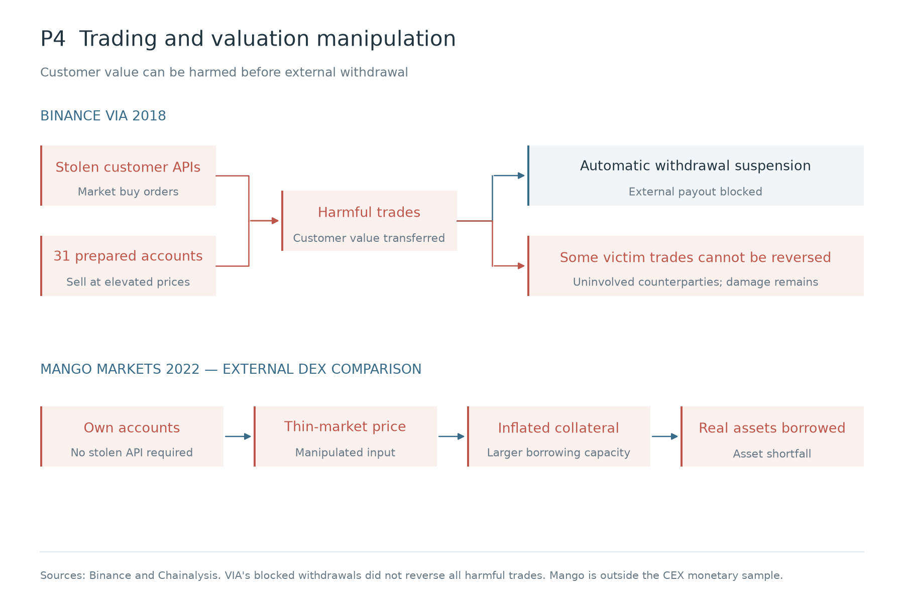

### 2.5 Erroneous crediting and double spending

Kraken disclosed a 2024 flaw that created account balances before deposits had actually completed. Researchers used it to withdraw approximately $3 million, followed by a dispute over authorization. ETC reorganizations demonstrate a different failure: a deposit initially appeared on-chain, the exchange accepted it and paid out other assets, and a later chain history removed the deposit. OKEx's related 2020 double-spend loss was approximately $5.6 million.

When an incomplete or subsequently reversed deposit becomes an available balance, a later withdrawal can pay out assets unsupported by a real deposit. Crediting checks need to establish asset identity, received quantity, and successful execution, then apply chain-specific confirmation and reorganization handling.

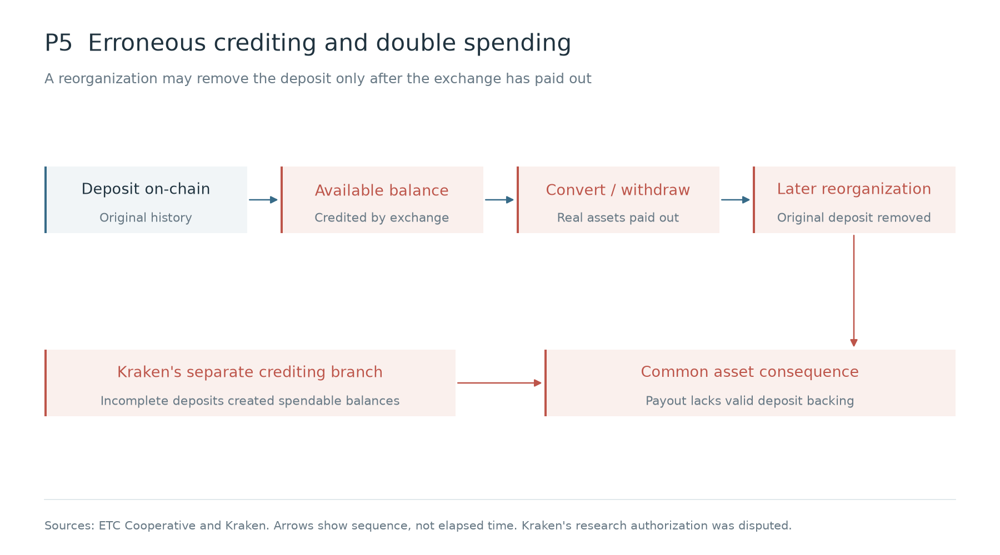

### 2.6 Deceiving customers into transfers or authorizations

Coinbase disclosed in 2025 that attackers bribed some overseas support personnel, obtained customer information, and used it for impersonation and social engineering. The attackers did not obtain customer passwords or private keys. Accurate account details helped establish a false support identity.

The FBI's fraud advisory describes generative AI used for fictitious identities, text, and synthetic audio and video. In support impersonation, real customer records supply account details while synthetic content helps fabricate the person communicating with the customer.

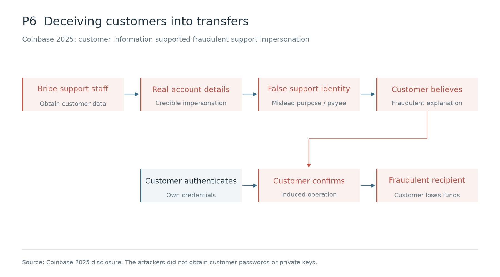

## 3. Recurring defensive weaknesses

### 3.1 Comparing fifteen incidents

| Cases | Attacker capability or exploited defect | Outcomes and differences |
| --- | --- | --- |
| Coinbase 2019 and 2023; WOO X 2025 | Employee credentials or endpoint access; WOO X progressed to production writes | Coinbase reported no customer-fund losses in either case. WOO X reached the backend, rewrote identity records, and initiated withdrawals. |
| Coincheck 2018; BitMart 2021 | Private-key material sufficient to sign | Funds left the platforms; signing was possible externally. Coincheck disclosed an inferred intrusion sequence; BitMart's initial entry remains unknown. |
| Gate.io 2018; DMM 2024; Bybit and Kiln 2025 | Withdrawal scripts, supplier communications, frontend resources, or API transaction responses | Malicious content affected fund operations. Request manipulation at DMM remains an investigative assessment. Bybit and Kiln changed on-chain control. Gate.io's total loss was not established. |
| Coinbase recovery 2021; support-personnel incident 2025 | Recovery token in the first case; customer information and impersonation in the second | Attackers transferred funds after takeover in the first case; customers were induced to act in the second. |
| Binance VIA 2018; Binance 2019 | Stolen customer credentials, APIs, or other authentication information used for fund operations | VIA withdrawals were blocked, but some harmful trades remained. In 2019, the alert followed the transfer of 7,000 BTC. |
| Kraken 2024; OKEx/ETC 2020 | Incomplete or later invalidated deposits became spendable balances | Real assets had already been paid out. Failures concerned crediting logic and chain finality respectively. Kraken involved disputed research authorization. |

Of these 15 cases, 4 involved an external service's input or communications, including DMM's possible chain. Of those, 3 explicitly involved malicious content triggered by page, wallet, or asset conditions, and 2 changed on-chain execution logic or withdrawal authority. Another 2 disclosed successful intervention without customer-fund impact. One blocked external withdrawals after some damaging trades had already occurred. These features overlap and are counted only where disclosed.

### 3.2 Several checks can share one compromised input

Bybit and Kiln signing processes approved modified transactions. At WOO X, the attacker changed customer identity records before requesting withdrawals. Kraken's crediting flaw converted incomplete deposits into withdrawable balances. Transaction, identity, or balance records were no longer trustworthy. Investigators need to trace approval back to original business requests, account changes, and actual settlement, and determine whether those records were altered.

Bybit and Kiln used transactions constructed or displayed by external services. The customers' signing processes depended on those outputs. A supplier could therefore influence what the customer signed without holding all of the customer's signing material.

BitMart's two wallets used one private key, so one leak affected both. At Bybit, multiple signers viewed the same tampered transaction display; their approvals did not provide independent checks.

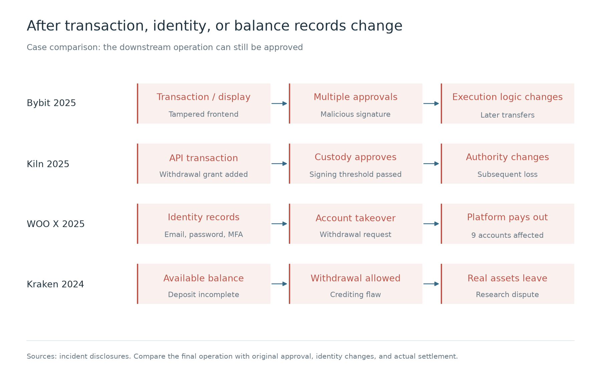

Transaction simulation predicts execution under a particular state. Establishing business approval also requires the original request and approval record. If the constructor can forge approval records, or shares administrative access with the validator, an attacker may change both the transaction and the evidence used to check it.

GTIG has documented malicious dependencies and workspace configuration used to influence AI coding assistants. Code, instructions, and tool responses read by an assistant can contain malicious directions. If that assistant can deploy or access production, induced actions may affect the trading system.

### 3.3 On-chain authority and later inflows

Bybit's execution-logic change and Kiln's withdrawal-authority change preceded subsequent transfers. In both cases, there was a stage when authority had changed but funds had not yet moved.

EIP-7702 permits an ordinary account to authorize execution delegation. The authorization signature differs from the outer transaction signature, and another address can submit it. Installing delegation and calling delegated code may occur in the same transaction. Execution failure does not roll back delegation that was already processed successfully.

Blocking a transaction type only at broadcasting misses a route in which the signing service produces an authorization that an attacker submits externally. After delegation takes effect, external transfer capability depends on the delegated code's permission checks. Suspending the exchange's own withdrawals may not prevent it.

After a hot wallet is compromised, automated replenishment, cold/warm-wallet transfers, and customer deposits may continue supplying assets. Reachable funds depend on how long the attacker retains authority, subsequent inflows, and whether the attacker can change limits. Estimates must deduplicate the same assets reachable through multiple paths.

Lowering the online balance reduces funds immediately exposed, while replenishment and transfers need separate restrictions. Stopping the business application does not invalidate existing signatures or revoke on-chain authority.

Clearing EIP-7702 delegation leaves token-contract allowances governed by their own state. If the private key has leaked, the attacker can sign again. These residual capabilities can threaten later deposits to an old address.

### 3.4 Trading, crediting, and lending risks

Some VIA trades could not be reversed despite blocked withdrawals. Kraken and ETC available balances respectively lacked a completed deposit and lost valid on-chain settlement backing. Mango demonstrates how an inflated valuation can become borrowing capacity.

Unified accounts, spot conversion, and collateralized lending transmit these problems across products. An erroneous balance permitted to trade can leave through another asset's withdrawal channel. An inflated collateral value can unlock real loans. Impact depends on permitted conversions and collateral uses. Abusive trades can transfer customer value while the platform's total ledger remains balanced; asset reconciliation alone may not identify the harm.

Completed trades and loans remain after withdrawal restrictions take effect. Resulting customer losses and credit exposure still need attention.

### 3.5 Wallet- and amount-specific triggers

The Gate.io script activated based on the withdrawal page, amount, or balance. Bybit's malicious frontend selected a particular wallet. Kiln's API targeted accounts with more than 150,000 SOL staked under the relevant withdrawal authority.

Ordinary accounts and small operations could continually receive normal responses. Kiln's malicious logic was changed directly in the running service, so inspecting repositories or images could miss the transaction actually returned to a customer. Validation needs to include target wallets, asset sizes, and the running environment.

### 3.6 Attribution in twelve incidents

Attribution comes from law enforcement, platform disclosures, researchers, or actor claims, distinguished below. Tools and laundering routes can be shared by different groups. Identifying a common operator also requires intrusion evidence.

| Incident | Actor and affiliation | Evidence and limits |
| --- | --- | --- |
| Bitfinex 2016 | Ilya Lichtenstein; individual | The US DOJ confirmed the intrusion and division of laundering roles. |
| Coinbase Firefox double zero-day, 2019 | CRYPTO-3 / HYDSEVEN; national affiliation unknown | Coinbase tracking label and alias. |
| DMM Bitcoin 2024 | TraderTraitor; North Korea-linked activity | Joint FBI, DC3, and Japanese police attribution; request manipulation is a possible chain. |
| Bybit 2025 | TraderTraitor; North Korea-linked activity | FBI attribution. |
| Binance 2026 | TraderTraitor; North Korea-linked activity | FBI attribution. The DevOps-to-container route is the platform's preliminary assessment; the complete chain is unknown. |
| WOO X 2025 | UNC4899 / UNC5565; platform-assessed North Korea link | Platform assessment; different report passages use inconsistent UNC labels. |
| Bitget 2026 | North Korea-linked activity; specific operation group unknown | Chainalysis assessment. |
| Nobitex 2025 | Gonjeshke Darande / Predatory Sparrow; national affiliation unknown | Actor claim; Chainalysis analyzed asset destruction. |
| SwissBorg / Kiln 2025 | Unknown | Supplier disclosure; the technical intrusion route was disclosed. |
| Coinbase support-personnel incident, 2025 | Unknown | Platform disclosure describes bribery and customer fraud. |
| Kraken crediting flaw, 2024 | CertiK Skyfall; security research team | Kraken disclosure and CertiK acknowledgment; scope of exploitation is disputed. |
| Coinbase SMS recovery, 2021 | Unknown | Customer notice; initial acquisition of customer credentials is unknown. |

### 3.7 Attacker profiles

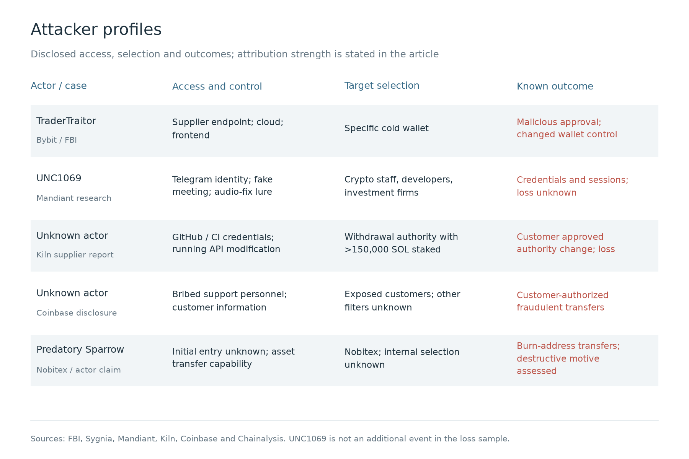

The UNC1069 profile comes from industry threat research and is not counted in the incident registry or monetary sample.

### 3.8 Changes in attack methods

DMM and Bybit were both attributed to TraderTraitor. Request manipulation in DMM remains an investigative assessment, while Bybit frontend tampering was confirmed. Kiln's operator is unknown, but API transaction modification and its effect on what customers signed were confirmed.

Developer and infrastructure-engineer tokens and sessions can provide access to repositories, deployment systems, or production. Attacks against signers can affect approvals; attacks against support personnel can yield information for later impersonation and fraud. The FBI's crypto-sector advisory describes researching employee backgrounds, contacting multiple people in parallel, and building relationships through recruitment or investment offers.

AppleJeus trading-software lures and the Gate.io external-script attack appeared in 2018. More recent development collaborations, supplier APIs, and staking services have created additional opportunities to contact personnel and alter transactions. Key theft, social engineering, and supply-chain attacks coexist. Deployment systems, running APIs, and customer signing workflows all appear in disclosed intrusion records.

Mandiant documented UNC1069's contact sequence: a compromised Telegram identity established contact; a fake meeting and an audio-repair pretext infected the endpoint; credentials, browser records, and sessions were collected. The report describes AI-assisted reconnaissance and tool development. The meeting video's suspected deepfake nature came from the victim's account and was not independently established through forensics. Stolen identities and sessions may also help attackers approach the victim's contacts.

GTIG observed an attacker plan, build, and execute an agent-assisted credential-collection operation in under six hours after obtaining cloud resources. NCSC's assessment through 2027 also expects AI to increase the efficiency of known-vulnerability exploitation.

Faster credential collection can accelerate the misuse of cloud, code, and administrative sessions on one endpoint. Cheaper lure production can increase attempts targeting developer collaboration and support conversations. Exchange exposure depends on whether those sessions can change fund systems and whether subsequent checks stop malicious operations.

## 4. Incident response findings

### 4.1 Response measurements

TTD measures an incident's interval from an established initial compromise to detection. MTTD averages comparable TTD observations. When initial compromise is unknown, the interval from a known behavior to detection is recorded separately, with its start identified. TTC runs from detection to verified effectiveness of a specified containment action, naming the operations, systems, and assets restricted. Eradication, such as removing persistence or fixing the entry point, is recorded separately. TTR runs from a stated start to a defined recovery condition; MTTR requires comparable endpoints, scope, and precision.

The 12 cases provide 7 usable time observations. Four cases have intervals calculable from disclosed dates or timestamps; another provides only a platform-reported upper bound for mitigation. Different endpoints and recovery scopes prevent a combined MTTR.

| Incident and measurement | Start → end | Result | Interpretation |
| --- | --- | ---: | --- |
| Coincheck 2018: disclosed transfer span | January 26, 00:02 → 08:26, Japan time | 504 minutes | Transfer span; detection unknown |
| Kraken 2024: discovery to mitigation | Platform awareness → mitigation; absolute timestamps undisclosed | Under 60 minutes | Self-reported upper bound, not recovery or return of funds |
| Bybit 2025: earliest known supplier compromise to asset attack | February 4 → February 21 | 17 calendar days | Begins at Safe; not Bybit's observable detection window |
| WOO X 2025: backdoor installation to loss date | July 8 → July 24 | 16 calendar days | Known-node interval, not complete dwell time |
| WOO X 2025: node containing first withdrawal to discovery/containment | July 24, 13:50 → 15:40, UTC+8 | 110 minutes | Combined disclosure nodes; detection and containment cannot be separated |
| Kiln 2025: malicious authority signature to discovery | August 31 → September 8 | 8 calendar days | Authority change to supplier discovery |
| Kiln 2025: discovery to recovery-status announcement | September 8 → October 7 | 29 calendar days | Actual restoration time of each service unknown |

Dates refer to each incident's year. Date-only intervals are calendar days.

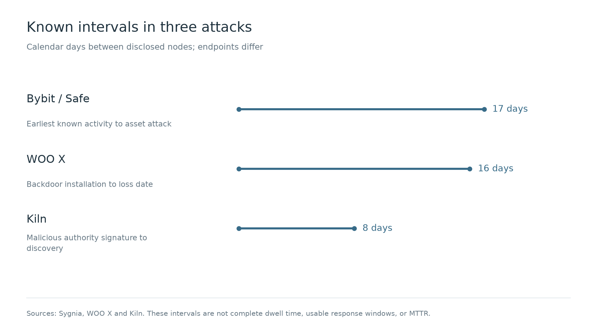

### 4.2 Intervention before external withdrawals

**Binance VIA, 2018.** Phishing contact began around January; actual account-compromise times are unknown. Abnormal trades occurred from 14:58 to 14:59 UTC on March 7. The risk system automatically suspended withdrawals during that period, before the attackers requested them. Binance reported resumption after checks, without exact suspension or restoration timestamps. Withdrawals were blocked; some victim trades with uninvolved counterparties could not be reversed. The two-minute period describes trading, not MTTR.

**Coinbase Firefox double zero-day, 2019.** Targeted emails were present by May 30. The exploit link was delivered at 06:31 on June 17; the report did not specify a time zone, and the host-compromise time was not precise. Coinbase reported detection and interruption within hours, with no customer-fund loss. Service restoration time is unknown.

**Coinbase employee social engineering, 2023.** An employee's password was phished on February 5; MFA blocked direct login. About 20 minutes later, the attacker impersonated IT by phone and induced workstation actions, exposing limited directory information. Customer funds and information were unaffected. Coinbase said its CSIRT intervened within the first 10 minutes of the attack but did not align that clock with the phone stage, leaving precise TTD unknown. Staff contact and access suspension were used. Cleanup was described as quick, without an exact restoration timestamp.

### 4.3 Intervention after funds left

**Coincheck, 2018.** The endpoint-intrusion date is undisclosed. The official FAQ places unauthorized NEM transfers between 00:02 and 08:26 Japan time on January 26. Detection and effective containment are unknown; 504 minutes is the disclosed transfer span. March 12 marks completion of reimbursement, not a known technical-recovery endpoint.

**Binance, 2019.** Initial intrusion time is undisclosed. At 17:15:24 UTC on May 7, 7,000 BTC left the exchange. The announcement states that an alert followed execution and withdrawals were immediately suspended. Neither a reproducible second-level delay nor technical-recovery completion was provided. The alert followed the first on-chain loss, unlike the pre-withdrawal control in VIA.

**Coinbase SMS recovery, 2021.** At least 6,000 customers experienced unauthorized transfers between March and May 20. Per-customer initial-compromise times are unknown. Attackers obtained account control through recovery. Coinbase changed the recovery protocol after learning of the issue; exact discovery, remediation, and full-recovery times were not disclosed.

**Kraken crediting flaw, 2024.** First exploitation is unknown. Approximately $3 million in disputed withdrawals preceded reporting. Kraken stated that mitigation took under an hour after discovery and that the flaw was fixed. Exact reporting, mitigation, and full-recovery timestamps are unknown. The interval starts at awareness and excludes earlier exploitation, repayment, and service restoration.

**WOO X, 2025.** A backdoor was installed on July 8. The July 24 timeline node at 13:50 UTC+8 combines backdoor reentry, account-record changes, and the first unauthorized withdrawal. The 15:40 node combines discovery and containment, including withdrawal suspension and account restoration. The nodes are 110 minutes apart. Exact first withdrawal, separate detection, and separate containment times are unknown. WOO X also described three subsequent weeks of investigation, remediation, and environment migration without a single completion time. Intervention began after funds were leaving.

### 4.4 Supplier compromise and changes to on-chain authority

**DMM Bitcoin, 2024.** A supplier employee received a recruitment lure in late March. Session-information abuse occurred after mid-May; funds left on May 31. The joint investigation assessed likely manipulation of a legitimate request, without exact discovery, containment, or technical-recovery timestamps. The intrusion crossed from supplier to exchange, so this chronology cannot establish the exchange's own detection latency.

**Bybit, 2025.** The earliest known malicious activity on the Safe developer endpoint was February 4. The malicious transaction and asset transfer occurred on February 21, 17 calendar days later. Precise detection, containment, and technical-recovery times are unknown. The attacker removed frontend code and traces two minutes after the malicious transaction. Controls did not stop it before the wallet's execution logic changed.

**SwissBorg / Kiln, 2025.** Initial GitHub-token compromise is undisclosed. The customer signed the malicious withdrawal-authority transaction on August 31; the supplier discovered unauthorized activity on September 8, 8 calendar days later. Kiln reported immediate containment and disabling potentially affected services without exact times. Its October 7 announcement said the listed services were available, 29 days after discovery; each service's actual restoration time is unknown. Control had changed before discovery, and disabling the API did not itself revoke that authority.

**Binance, 2026.** The FBI dated the asset incident to October 29. Binance's initial account described possible DevOps endpoint compromise, service-container access, and unauthorized withdrawals, followed by additional breach points. Initial endpoint compromise and precise detection time are unknown. Binance reported suspended withdrawals and revoked authorizations for affected addresses, without reproducible effective timestamps. Its November 1 announcement described staged restoration plans and asset replenishment. Actual service restoration and complete eradication times remained unknown.

### 4.5 Comparing intervention outcomes

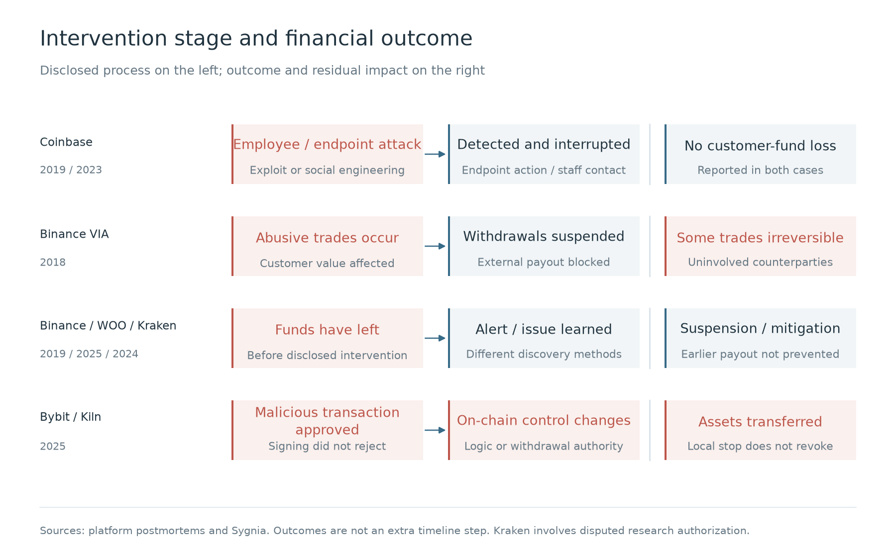

Bybit's 17 days and WOO X's 16 days cover different environments and stages. Some early evidence belonged to a supplier; subsequent exploitation depended on signing, transfers, or particular account states. After detection, an exchange still needs to map affected business operations, obtain action authority, and apply restrictions. Unrevoked on-chain authority or valid signatures held by the attacker can allow transfers after withdrawal suspension.

### 4.6 Residual risk after recovery

CoinDCX disclosed in 2026 that a wallet address affected by the previous year's incident continued receiving customer deposits. The platform credited customers and used another service to sweep funds. When sweeping failed, assets accumulated at the old address, eventually resulting in approximately 15.99 million USDT lost. The announcement did not disclose the complete process by which the second attacker obtained asset control.

Removing an address from the product interface does not prevent customers from paying an address they saved. If the platform continues recognizing and crediting these deposits, it also needs to establish that the assets can reach a controlled wallet. Sweep failures leave funds accumulating at the old address.

ShapeShift's 2016 postmortem already documented renewed compromise during reconstruction: insider assistance and endpoint malware allowed continued access to new credentials. Replacing servers and keys did not remove the path to those credentials.

In 2026, Zilliqa disclosed a nonce-handling defect in an older Ledger application's transaction-signing flow. Historical public signatures could expose affected private keys. A KuCoin cold-wallet anomaly helped trigger the investigation. The chain disabled affected old transaction types on July 20. Application fixes do not remove historical signature exposure; affected keys still need retirement.

### 4.7 Conversion, freezing, and destruction

Elliptic estimated approximately $97 million stolen in Liquid's 2021 incident, including about $45 million in Ethereum tokens converted to ETH. Conversion reduced the opportunity for token issuers to freeze those assets. The Binance incident likewise involved stablecoin freezing alongside transfers of other assets.

Native assets generally lack an issuer-operated freezing interface. Once stolen tokens are exchanged for such assets, the original issuer cannot stop subsequent transfers by freezing the original tokens. Frozen assets still require an applicable return process.

Predatory Sparrow claimed the 2025 Nobitex attack. Chainalysis assessed that assets were sent to addresses that could not normally be controlled, suggesting political destruction rather than monetization. Stopping later exchange or cash-out cannot recover assets already destroyed.

## 5. Priorities for exchange defense

### 5.1 High-risk production access

Exposed credentials, active exploitation, and confirmed unauthorized production access require immediate containment. Longer-term priorities depend on reachable assets, surviving independent checks, and the business impact of changes.

WOO X sessions and backend access were used to rewrite accounts. Kiln repository tokens and CI credentials enabled production access and changed transaction responses. Identities that can deploy transaction code, reset customers, read keys, or relax fund rules deserve particular attention. Endpoint, identity, cloud, and runtime controls protect these entrances. Asset limits, authorization checks, and replenishment restrictions reduce consequences after entry.

Developers routinely run external code, debug production, and integrate suppliers. When an AI coding assistant shares an environment with production credentials, malicious dependencies, workspace configuration, or tool calls may expose those credentials. Separating experimentation from production access, shortening grants, and reducing persistent secrets have engineering and operational costs. Validation should identify systems reachable after identity compromise and test normal login, existing sessions, and recovery separately.

Separating the ability to change fund requests from the ability to change their validation rules is a priority where one identity holds both. Where independent checks already reject malicious requests, concentrate on detection delay, residual reachable assets, and post-recovery access. Use these results to allocate resources.

### 5.2 Wallets, risk controls, and accounting

Bybit and Kiln malicious transactions passed signing. VIA harmed customers during trading. Kraken and ETC losses involved the creation of available balances. Transaction verification, trading risk controls, and crediting checks therefore involve wallet, business, and accounting systems. Transfers signed externally with stolen private keys do not traverse the exchange application's withdrawal-risk controls.

| Fund risk | Defense priority | Business impact and limits |
| --- | --- | --- |
| Key or on-chain control compromised | Protect the key lifecycle; constrain assets controlled by one signing capability; independently limit replenishment and delegation | Lower online balances increase transfer frequency. Application limits only constrain the platform's own path; external signing capability requires separate handling. |
| A malicious transaction obtains a valid signature | Compare final bytes and expected authority changes with the original request; separate construction and validation administration | Incomplete parsing coverage constrains new chains and products. Unexplained high-risk operations must remain restricted, affecting launch and liquidity. |
| Recovery or backend writes change the authorized identity | Constrain recovery, administrative writes, and credential resets; correlate unusual identity changes with withdrawals | Review slows customer recovery. Targeted restrictions require dependable account-to-operation mappings. |
| A deceived customer authorizes a transfer | Limit customer-data misuse; combine reports, anomalous actions, and anti-fraud verification | Extra verification inconveniences genuine customers. The exchange has no universal suspension switch for self-custodied funds outside the platform. |
| Trading, valuation, or crediting creates realizable value | Apply separate constraints at execution, lending, and crediting; trace value into other products | Restricting new positions, loans, and withdrawals has different effects. Halting all liquidation can worsen existing position risk. |

These checks depend on chain nodes, price feeds, and identity data, as well as rule deployment, emergency overrides, and withdrawal orchestration. A common administrator controlling data, rules, and releases may alter several checks together. Simulation predicts a particular state; release conditions must still be checked before broadcast, and actual balances and authority reconciled afterward. New loans can pause when a risk service times out, while existing positions still require liquidation-risk management. In-flight transactions and generated signatures need continued state tracking.

Limits also need concurrent-execution tests. Multiple requests can each read the same remaining allowance and exceed it in aggregate. Signed, unconfirmed transactions may still consume capacity; retries can duplicate spending. Validation must follow reservations, in-flight exposure, and final settlement rather than isolated approval results.

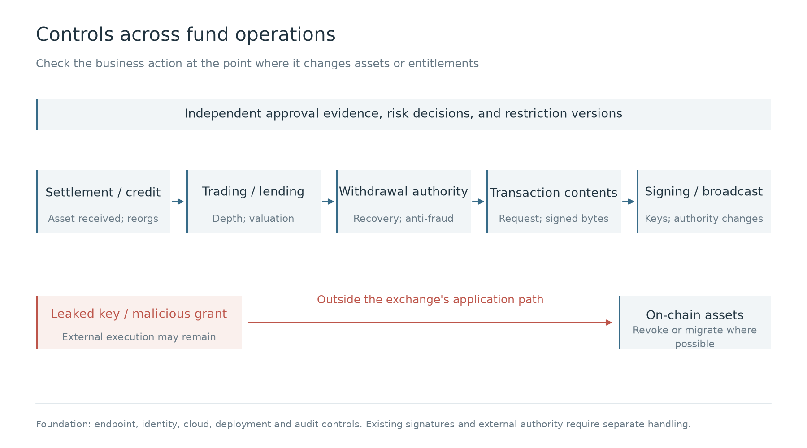

### 5.3 Business integration and departmental handoffs

Unified accounts, lending, staking, and multichain integrations give one balance more uses. Treasury manages liquidity; developers implement balances and state changes; wallets sign; risk functions constrain accounts, trading, and credit. Allowing a balance to serve as collateral affects accounting, loan capacity, and lendable funds. Review must follow balance changes through final withdrawal.

The security team assigns specialist functions to the relevant risks. Application security and developers review authorization design, code, and exceptional states. Infrastructure and identity security examine production access. Wallet and contract security review signing and on-chain authority; data security reviews sensitive access. Security operations detect and respond, while red teams test cross-system attack paths. GRC tracks control operation and risk exceptions, with unresolved risk decided by an authorized business owner. System teams remain responsible for implementation, fixes, and maintenance.

Frontends, transaction-construction APIs, and security products with production privileges can all influence fund approval. Supplier review must examine what a service can actually change, including non-custodial services. The DMM regulatory findings describe concentrated development, operational, and security-management permissions, self-supervision, and insufficient external wallet evaluation.

Supplier integration brings costs for log access, transaction checks, revocation, and migration. Without server-side logs, an exchange can still inspect returned transactions but may be unable to reconstruct upstream intrusion. Restricting assets and operations accessible to a supplier can reduce available functionality.

After an employee leaves, service tokens, deployment accounts, and earlier exceptions may remain active. Disabling the personal account misses these dependencies. System owners, IT, and identity teams need to reconcile purpose, ownership, and revocation effects, leaving records for the next maintainer.

When security operations identifies a compromised production identity, it needs to determine affected customers and withdrawal requests. Risk restrictions must reach the wallet's actual signing tasks. Batching, splitting, and retries can change requests, so orchestration must retain mappings to original business orders and approval versions. Engineering, risk, and wallet teams jointly verify that requeued jobs remain restricted. OWASP transaction-authorization guidance calls for renewed authorization after content changes and a final check before execution.

After confirmed takeover, access isolation and associated business restrictions can proceed in parallel. An unresolved signal meeting predefined high-risk conditions can justify temporary restrictions while investigation continues. Each restriction needs a review deadline and release authority; unresolved expiry escalates. Withdrawal suspension, loan restrictions, and liquidation suspension have different costs, so business owners must establish action authority in advance. Customer reports and anomalous queries or fund behavior can also trigger backend investigation. Records distinguish receipt, execution, and verified effect. Compromised systems require independent result checks.

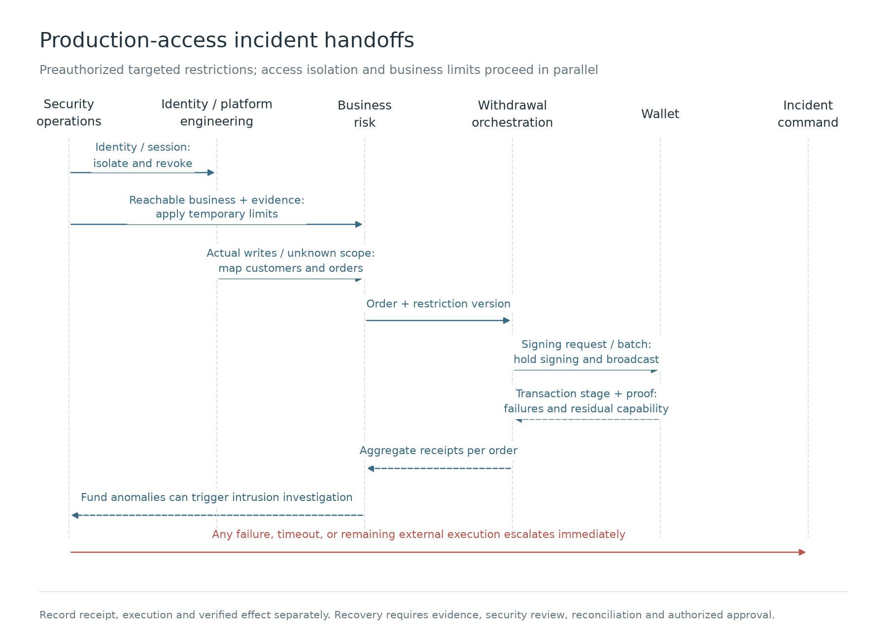

### 5.4 Agent-based work across the security team

Attackers continue from endpoints through production permissions into fund operations. Investigation, containment, repair, and retesting need to continue as well. Agents can undertake authorized queries, analysis, and execution. Engineers build those capabilities, supervise quality, and resolve difficult judgments. Departmental waits, repeated background collection, and duplicated evidence gathering consume time that could otherwise limit losses.

Consider security operations investigating a compromised production identity. A real-time engine can query sessions, cloud permissions, deployments, and database changes in parallel, then map affected accounts and withdrawals. Investigations share case state distinguishing confirmed changes, reachable objects, and unknown scope. Once predefined conditions are met, execution restricts sessions and withdrawals, checking actual results through identity platforms, accounting, and the chain. Experts use one workbench to challenge evidence and add business context; authorized people approve actions beyond existing delegation. Continuing analysis is event-driven rather than dependent on a person starting each conversation. Existing products supply data and execution APIs; the exchange retains cases and evidence.

Wallet, engineering, risk, and security personnel know production permissions, permitted staking operations, and legacy-address deposit arrangements. Matching that context to logs establishes which assets an action can affect. Confirmed judgments can become agent-callable skills, enforced policies, and evaluation cases with known answers, each with an owner, version, and scope. Successors can maintain them; replacement models or suppliers can be tested against the same cases.

Application security establishes authorization and validation requirements during design, then reviews implementation through code audits and business-logic tests. If an investigation finds that a transaction constructor can forge business approval, remediation must add approval-origin verification and forged-request regression cases. Agents can inspect similar code, draft fixes, and extend tests. Application security verifies the fix, and independent release gates remain. Wallet, recovery-rule, and withdrawal-orchestration changes trigger related attack tests again.

Red-team work extends to continuous validation. Historical chains can be replayed within authorization, while specialists explore combinations outside existing tests and challenge risks omitted by builders or business teams. Generation and review agents sharing a model, context, or rules can miss the same problem. Validation retains independent hypotheses, test authority, and evidence channels, checking actual funds, permissions, and business state. Malicious tickets, repository content, and supplier responses should also test whether an agent can be induced to exceed authority, alter policies, or contaminate evaluations.

Security architecture and agent engineers maintain interfaces, policy enforcement, and execution boundaries. Specialist functions own their domain tasks. GRC can use agents to correlate control requirements, actual execution records, and outstanding issues. Exceptions require authorized approval, expiry, and review records. Security business partners coordinate with the business; material risk decisions remain with authorized business owners. Incident conclusions enter evaluations only after forensics and specialist review, rather than treating an agent's preliminary judgment as the answer key.

Investment can begin with one fund-operation chain. Reuse general models and runtimes while retaining business context, response policy, skills, evaluations, and evidence. Replay history and run shadow tasks to observe false releases, false restrictions, and human takeover before widening execution authority by scenario. Known urgent threats continue to use preauthorized blocking. Measure time to locate an anomaly, verify containment, retest fixes, and validate new changes. Maintaining expert knowledge, evaluation cases, and corrected conclusions is part of the investment.

Before restoration, verify that access, deployment, and fund paths between the proposed recovery scope and unresolved systems are restricted. Security and technical teams recheck sessions and service credentials; wallet teams examine on-chain authority; treasury and accounting reconcile assets and in-flight operations. Shared administrative or deployment access that remains exploitable keeps the associated business restricted. Confirmed losses may remain subject to recovery efforts; unexplained discrepancies constrain restoration.

Staged restoration limits reopened business and funds. Validation still needs high-value wallets and targeted triggers, old-address inflows, signed transactions, and historical grants. Monitoring failure or renewed anomalies must permit fresh restrictions. Broadcast transactions cannot be assumed reversible.

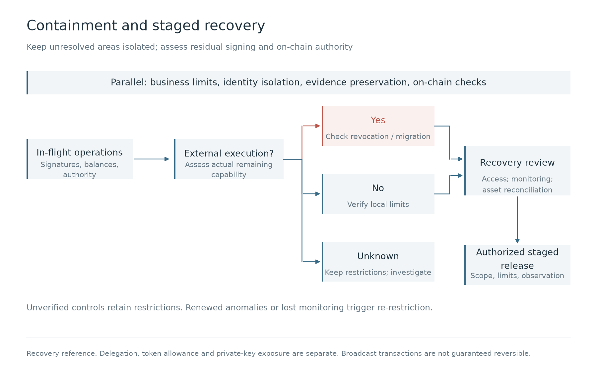

See the [defense matrix](defense-matrix.md) for responsibility assignments and acceptance criteria.

### 5.5 Conclusion

Wallets sharing signing material are jointly exposed to one key leak. A tampered display can lead multiple signers to approve one malicious transaction. After identity changes or inflated balances, downstream systems checking only current account records may still approve withdrawals. Even after platform withdrawals stop, an attacker may transfer assets externally from addresses they control, including later deposits.

Attack automation can accelerate credential collection and exploitation. Defenders also need to reduce waits between investigation, restriction, repair, and retesting, while retaining confirmed judgments for future work. Agent tool permissions, consumed content, and the evidence and test cases used to evaluate agents all require protection.

With limited resources, prioritize permissions that can alter fund instructions, customer identity, and available balances. Preserve independent intervention capabilities in wallets, trading risk, and accounting. Validation should establish reachable assets, whether anomalous balances remain spendable, whether containment took effect, and whether old credentials and authorizations remain usable after recovery. Recheck those conclusions after new products, suppliers, and permission changes.

---

**References**

- [Binance initial security update](https://www.binance.com/en/support/announcement/detail/c5a8729a97ac486d963784d96c5642d7)
- [Binance second update](https://www.binance.com/en-TR/support/announcement/detail/d3306d9dca5243548c813b605e1d1751)
- [FBI Binance attribution](https://www.fbi.gov/investigate/cyber/alerts/2026/north-korea-responsible-for-6-billion-binance-attack)
- [Binance recovery arrangements](https://www.binance.com/en/support/announcement/detail/73911fb819b240f88b88256bdd318eda)
- [Elliptic Binance analysis](https://www.elliptic.co/insights/binance-largest-hack-in-history/)
- [Binance VIA postmortem](https://www.binance.com/en/support/announcement/detail/360001547431)
- [Binance 2019 security notice](https://www.binance.com/en-AU/support/announcement/detail/360028031711)
- [Sygnia Bybit investigation](https://www.sygnia.co/blog/sygnia-investigation-bybit-hack/)
- [FBI Bybit attribution](https://www.ic3.gov/PSA/2025/PSA250226)
- [FBI/DC3/Japanese police DMM investigation](https://www.fbi.gov/news/press-releases/fbi-dc3-and-npa-identification-of-north-korean-cyber-actors-tracked-as-tradertraitor-responsible-for-theft-of-308-million-from-bitcoindmmcom)
- [DMM regulatory findings](https://lfb.mof.go.jp/kantou/kinyuu/pagekthp0270000030.html)
- [Kiln postmortem and restoration](https://www.kiln.fi/post/re-enablement-of-kiln-services-and-security-incident-information)
- [WOO X technical postmortem](https://woox.io/blog/july-24th-security-incident-post-mortem)
- [Coincheck FAQ](https://coincheck.com/info/faq_nem)
- [BitMart security update](https://www.bitmart.com/en-US/support/articles/7922665245339/7923672421147/4411998987419)
- [BigONE technical explanation](https://bigoneeurasia.ladesk.com/275817-Temporary-Platform-Maintenance)
- [Bitget investigation](https://www.bitget.com/academy/bitget-security-incident-what-happened-timeline-impact-response)
- [Chainalysis Bitget analysis](https://www.chainalysis.com/blog/387m-bitget-theft-2026/)
- [Coinbase Firefox incident response](https://www.coinbase.com/blog/responding-to-firefox-0-days-in-the-wild)
- [Coinbase employee social engineering](https://www.coinbase.com/en-ca/blog/social-engineering-a-coinbase-case-study)
- [Coinbase 2021 customer notice](https://oag.ca.gov/system/files/09-24-2021%20Customer%20Notification.pdf)
- [Coinbase 2025 disclosure](https://www.coinbase.com/en-nl/blog/protecting-our-customers-standing-up-to-extortionists)
- [Coinbase SEC filing](https://www.sec.gov/Archives/edgar/data/1679788/000167978825000094/coin-20250514.htm)
- [Kraken vulnerability disclosure](https://blog.kraken.com/product/security/kraken-bug-bounty-program-patches-isolated-bug)
- [CertiK statement](https://www.certik.com/blog/certik-statement-on-kraken-vulnerability)
- [ETC Cooperative board materials](https://etccooperative.org/ETC-Coop-Board-Package-August-2020.pdf)
- [3Commas API disclosure](https://3commas.io/blog/notice-on-api-data-disclosure-incident)
- [3Commas incident FAQ](https://3commas.io/blog/api-security-incident-faq)
- [US DOJ Bitfinex case](https://www.justice.gov/archives/opa/pr/bitfinex-hacker-sentenced-money-laundering-conspiracy-involving-billions-stolen)
- [Chainalysis Nobitex analysis](https://www.chainalysis.com/blog/nobitex-iranian-exchange-exploit-june-2025/)
- [CoinDCX old-wallet update](https://coindcx.com/blog/coindcx-news/on-chain-wallet-activity-update-21-oct-2026)
- [ShapeShift and Ledger Labs postmortem](https://postmortem.io/incidents/shapeshift--2016-04-19--cyberattack-postmortem/)
- [Zilliqa Ledger application postmortem](https://www.zilliqa.com/ledger-incident/post-mortem/)
- [Elliptic Liquid analysis](https://www.elliptic.co/insights/liquid-exchange-hacked-94-million-stolen/)
- [OpenZeppelin Parity analysis](https://www.openzeppelin.com/news/on-the-parity-wallet-multisig-hack-405a8c12e8f7)
- [Chainalysis Mango mechanism](https://www.chainalysis.com/blog/oracle-manipulation-attacks-rising/)
- [FBI crypto-sector social engineering advisory](https://www.ic3.gov/PSA/2024/PSA240903)
- [FBI generative-AI fraud advisory](https://www.ic3.gov/psa/2024/psa241203)
- [Mandiant UNC1069 investigation](https://cloud.google.com/blog/topics/threat-intelligence/unc1069-targets-cryptocurrency-ai-social-engineering?linkId=49659601)
- [Kaspersky AppleJeus investigation](https://www.kaspersky.co.uk/blog/lazarus-crypto-exchange-attack/14314/)
- [TraderTraitor joint advisory](https://www.ic3.gov/CSA/2022/220418.pdf)
- [GTIG adversarial AI report](https://cloud.google.com/blog/topics/threat-intelligence/from-prompting-to-autonomy-the-evolution-of-adversarial-ai)
- [NCSC AI threat assessment through 2027](https://www.ncsc.gov.uk/report/impact-ai-cyber-threat-now-2027)
- [EIP-7702 specification](https://eips.ethereum.org/EIPS/eip-7702)
- [ERC-20 specification](https://eips.ethereum.org/EIPS/eip-20)
- [OWASP transaction authorization](https://cheatsheetseries.owasp.org/cheatsheets/Transaction_Authorization_Cheat_Sheet.html)
- [OWASP business-logic security](https://cheatsheetseries.owasp.org/cheatsheets/Business_Logic_Security_Cheat_Sheet.html)
- [NIST authentication](https://pages.nist.gov/800-63-4/sp800-63b/authenticators/)
- [NIST session management](https://pages.nist.gov/800-63-4/sp800-63b/session/)
