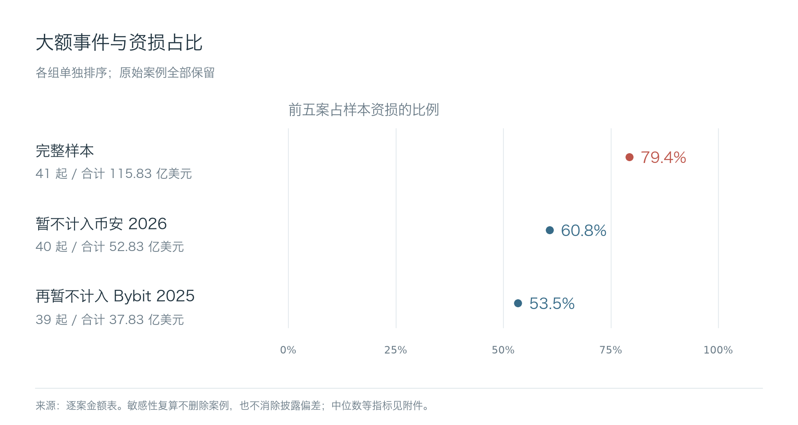
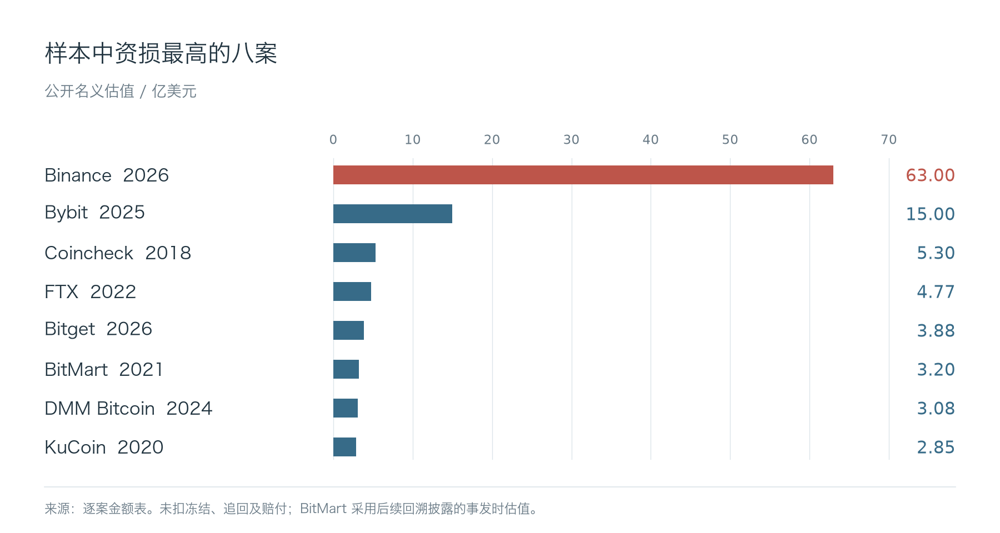
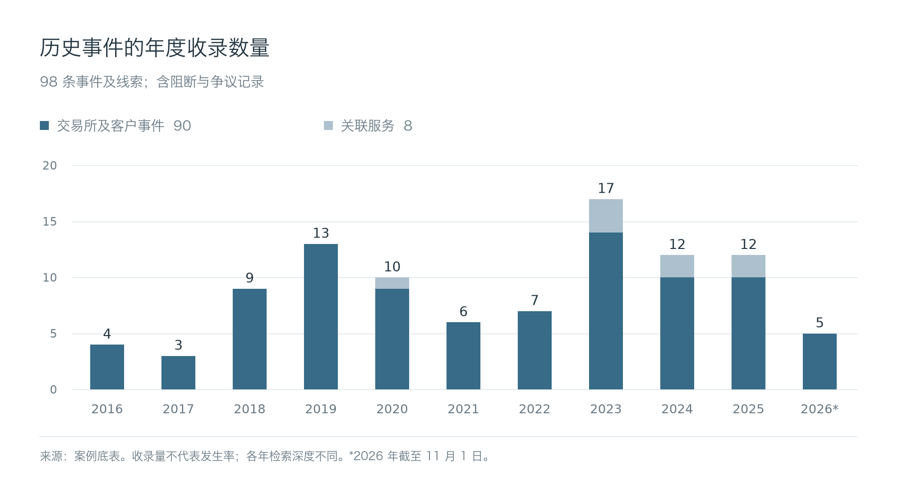

# 统计方法与数据说明

[English](../en/methodology.md) | **简体中文**

## 研究范围

研究覆盖2016年至2026年11月1日的公开材料，不包含访问受害方内网、非公开访谈或独立链上全量取证。

事件目录包含**98条事件及线索**：90条交易所及客户相关事件、8条关联服务事件。除盗币外，也保留成功阻断、数据事件和研究授权争议。其中38条目前仅有事件索引，5条在性质或归属上存在争议。Mango Markets和Parity用于解释外部机制，不进入事件及金额样本；UNC1069属于威胁活动画像，不额外计作资损事件。

41起金额样本要求：存在可识别的交易所托管或业务资损，有索引以外的明确美元估值，并能与其他服务、应对成本和返还分开。未知金额不记为零。正文的15案比较和12案归因、响应分析属于用途不同的子样本。

样本更容易收录大额、英文披露充分及近期事件，不能据此计算全行业发生率、攻击成功率或某项技术的失效概率。年度数量表示当前目录的收录情况，不等于当年实际攻击数量。

## 金额口径

使用事发时的名义美元估值，不按当前币价重估，不做通胀调整。冻结、追回和赔付不从盗取金额直接扣减。稳定币面值是近似值，各来源的公开估值也不是统一审计结果。

BitMart采用平台后续回溯披露的**3.195亿美元**，仍按2021年12月4日估值，另保留常见的**1.96亿美元**口径作比较。Nobitex的“超过9000万美元”按9000万美元近似，不代表上界。Coinbase 2025年的应对及赔付成本、HTX与HECO合并数字，以及Kraken研究争议提款不进入资损合计。

| 计算范围 | 事件数 | 合计，百万美元 | 中位数，百万美元 | 最大一案占比 | 前五案占比 |
| --- | ---: | ---: | ---: | ---: | ---: |
| 完整金额样本 | 41 | 11,582.86 | 45.00 | 54.4% | 79.4% |
| 暂不计入Binance 2026 | 40 | 5,282.86 | 44.60 | 28.4% | 60.8% |
| 再暂不计入Bybit 2025 | 39 | 3,782.86 | 44.20 | 14.0% | 53.5% |
| 采用已列出的替代估值 | 41 | 11,572.76 | 45.00 | 55.6% | 80.3% |
| 仅把BitMart换回1.96亿美元 | 41 | 11,459.36 | 45.00 | 55.0% | 80.2% |

正文使用完整样本。暂不计入大额事件是检查统计对极端值的依赖，不删除原始记录，也不产生更准确的行业总额。每组计算重新排序前五案。替代估值只检查已发现的特定口径差异，不是置信区间，也未覆盖全部误差。

## 证据、归因与攻击路径

证据代码表示来源类型，不是数值化的可信度评分：

| 代码 | 含义 |
| --- | --- |
| P | 平台或参与方披露、法律及官方记录 |
| I | 独立安全或链上调查 |
| M | 媒体报道 |
| C | 事件索引 |

组合代码保留已取得的来源类型。官方说明仍有自身的证据限制，平台判断不自动等于独立取证结论。正文分别说明团伙认领、研究标签和执法归因；工具或洗钱渠道相似不能单独确认同一操作者。

六条路径按照资金控制如何失效归类，初始进入方式、攻击者身份和后续后果分别描述。同一事件可经过多条路径，不能用路径归类数量计算攻击频率。

## 响应指标

12起响应案例中，5起提供7项可用时间数据。TTD从明确的初始失陷计到发现；初始时刻未知时，单独标注已知行为到发现的间隔。TTC计到指定遏制措施验证生效。TTR要求明确起点和恢复条件。计算MTTD或MTTR，需要范围、端点和精度可比。

现有数据包括转出跨度、供应商侧入侵间隔、平台自报的缓解上限、合并披露的发现与遏制节点，以及恢复状态公告，不能合并成一个MTTR。赔付、补充资产、冻结和实际技术恢复分别记录。

## 数据文件与字段

| 文件 | 内容 |
| --- | --- |
| [case-registry.csv](../../data/case-registry.csv) | 稳定事件ID、公开日期、对象、范围、证据类型、来源标识及URL |
| [loss-sample.csv](../../data/loss-sample.csv) | 入选事件ID、日期、对象、选定百万美元估值及金额来源 |
| [alternative-estimates.csv](../../data/alternative-estimates.csv) | 敏感性计算使用的逐案替代估值 |
| [response-observations.csv](../../data/response-observations.csv) | 7项时间数据及定义、限制 |
| [sources.json](../../data/sources.json) | 研究来源标识与URL对应表 |
| [statistics.json](../../data/statistics.json) | 金额汇总、年度收录、证据数量及已知节点间隔 |

日期保留公开材料的精度，不把范围擅自改成单一时间点。范围字段分别为`custody_and_business_systems`（托管资金与业务系统）、`customer_accounts_and_information`（客户账户及信息）、`related_service`（关联服务）。多个来源标识及URL用分号分隔。未入选金额样本表示**不满足该样本的选取规则**，不表示没有损失。

在仓库根目录运行`python3 scripts/check.py`，可检查本地链接、双语文档、事件ID、样本对应关系、金额与敏感性计算及配图引用。检查验证的是仓库一致性，不代表逐项认证了外部来源，也不证明建议的防御已经有效。
