# 从 Bybit 到币安：黑客如何攻破交易所

[English](../en/research.md) | **简体中文**

**作者：**

Max Luo｜加密交易所 AI 安全与自动化负责人 
Morgan Chen｜加密交易所 AI SOC 平台负责人

> 回溯交易所近十年的安全事件，追踪攻击者如何进入系统、取得资金控制权，分析防御失效的环节与反复出现的安全盲点。

2026 年 10 月 30 日，币安披露一起涉及约 63 亿美元资产的安全事件。初步调查指向一名 DevOps 工程师的笔记本电脑：攻击者可能通过受入侵终端访问服务容器，提交未经授权的提现交易。随后，币安表示又发现了其他入侵点，尚无证据表明钱包私钥泄露，完整攻击链路仍待披露。次日，FBI 将攻击归因于朝鲜关联的 TraderTraitor。

过去十年，攻击者通过开发环境、供应商服务和业务后台接近交易所资金。交易展示被篡改，签名人就可能批准恶意操作；后台身份或余额记录被修改，后续提现检查也可能依据错误记录放行。

## 一、币安与 Bybit 两案占样本资损的 67.3%

### 1.1 41 起资损事件，合计约 115.83 亿美元

98 条记录包括 90 条交易所及客户相关事件、8 条关联服务事件，涵盖盗币、数据泄露、成功阻断和研究人员测试。其中 38 条目前仅收集到事件索引，缺少详细技术材料。Mango Markets 与 Parity 用于解释相关攻击机制，未计入事件数量及资损合计。

其中 41 起有可单独统计的实际资损估值。各案采用公开的事发时名义美元估值，未扣除冻结、追回或平台赔付。

| 统计范围 | 事件数 | 样本资损合计 | 单案中位数 | 最大一案占比 | 前五案占比 |
| --- | ---: | ---: | ---: | ---: | ---: |
| 全部金额样本 | 41 | 约 115.83 亿美元 | 4,500 万美元 | 54.4% | 79.4% |

*数据由逐案金额表计算。样本更容易收录大额、公开披露充分的事件，不能代表全行业损失分布；选值与复算见[统计方法](methodology.md)。*

按样本采用的金额口径，币安 2026 年事件约 63 亿美元，Bybit 2025 年事件约 15 亿美元，两起合计 78 亿美元，占 41 起样本资损的 67.3%。币安单起占 54.4%。

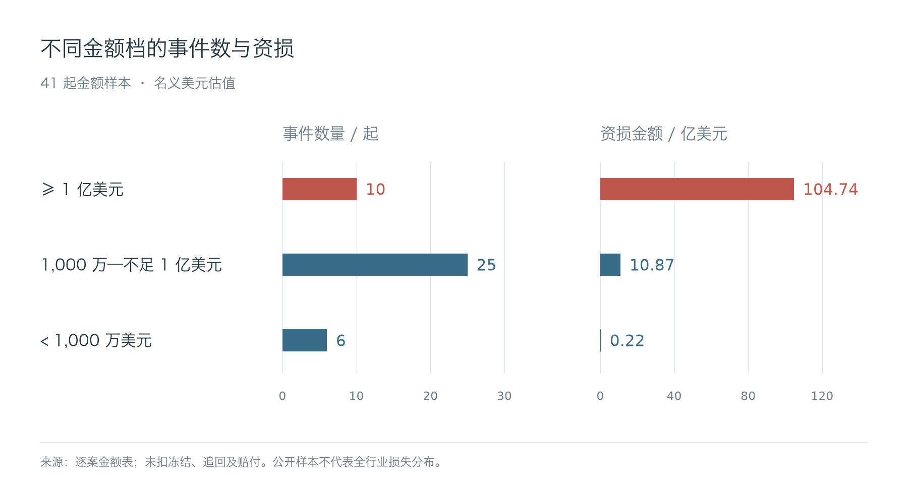

Coinbase 2025 年披露的 1.8 亿至 4 亿美元，是应对和自愿赔付的初步成本估计；HTX 与 HECO 的合并数字包含跨链桥；Kraken 的约 300 万美元涉及研究人员测试与授权争议。这些数字未计入上述资损合计。

代币未必能按事发时的估值全部卖出。实际成交价格、冻结与追回会改变攻击者所得和平台最终损失。

## 二、六条主要攻击路径

公开案例中的资金损失涉及多个环节：攻击者利用被盗私钥转移资产，篡改交易内容以取得有效签名，或接管账户后发起提现。交易与账务环节也存在风险，异常成交可以转移客户权益，虚高的抵押估值可能扩大借款额度，错误入账则可能被兑换或提现。

部分攻击以客户为目标。攻击者冒充客服等可信身份，诱使客户主动转账或授权，泄露的账户资料还可用于增强欺骗性。在这类事件中，客户可能正常登录并完成验证，但对收款方或操作目的作出了错误判断。

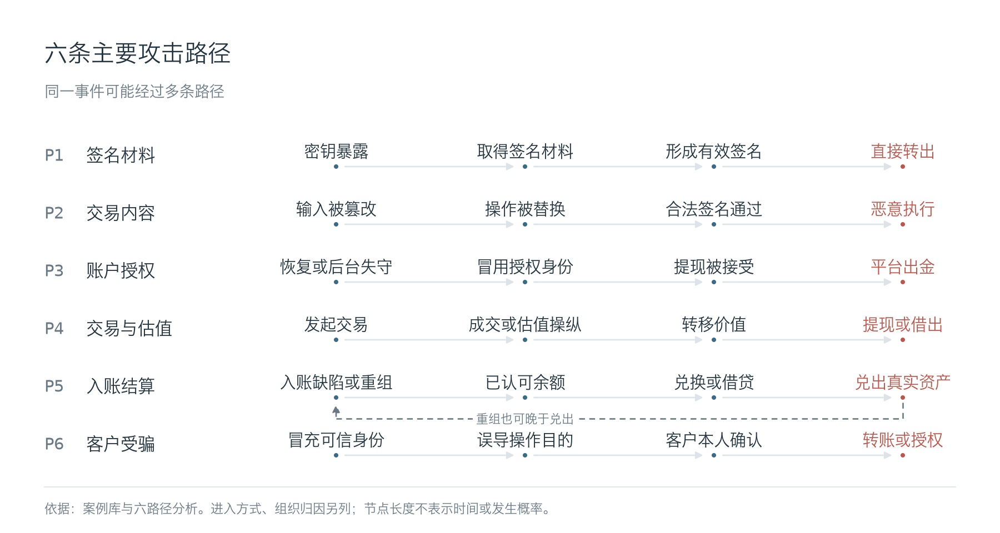

### 2.1 签名材料泄露

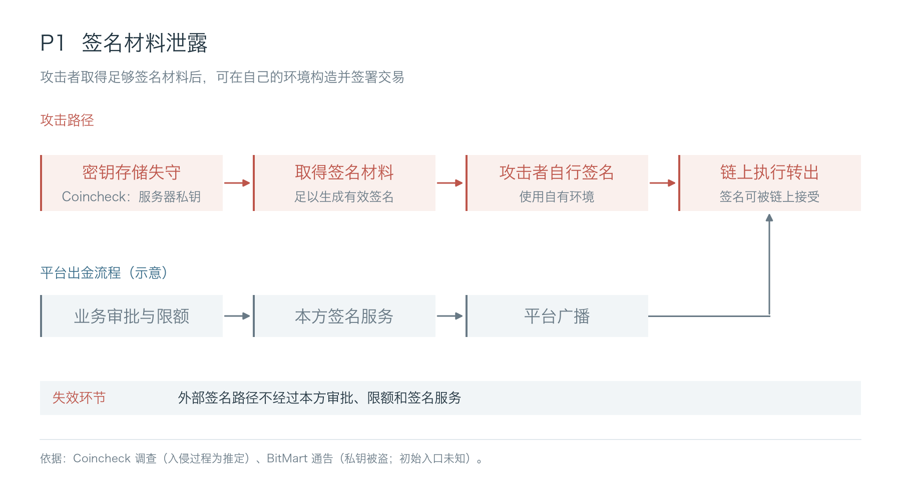

Coincheck 对 2018 年 NEM 事件的调查推定，员工终端感染恶意程序后，攻击者经终端进入内网，在 NEM 服务器侧窃取私钥。BitMart 2021 年也确认私钥被盗，但未完整披露最初入口。

攻击者取得足够签名材料后，可以在自己的环境发起交易，交易所应用里的审批、限额和停提不一定再被调用。密钥在生成、存储、使用、备份和恢复时都可能泄露。签名实现存在缺陷时，历史公开签名也可能被用于恢复私钥。

### 2.2 交易内容篡改

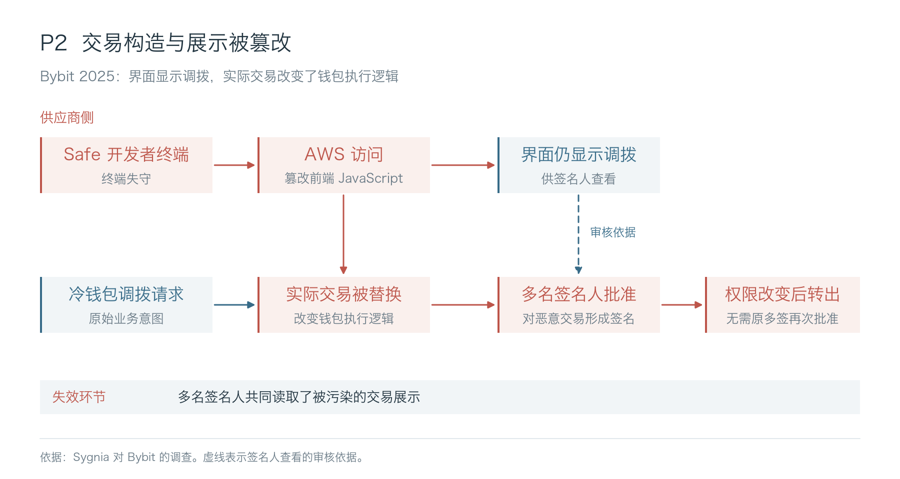

Bybit 2025 年事件中，Safe 开发者终端失守，攻击者取得云访问并篡改前端资源。冷钱包调拨时，签名人接触到被污染的交易界面，恶意交易改变了钱包执行逻辑，后续资产转移不再需要原来的多签批准。

SwissBorg / Kiln 事件中，攻击者利用 GitHub 令牌取得 CI 凭据，进入生产环境后修改运行中的 API。客户请求解除质押，API 却夹带更换提款权限的交易，随后在客户自己的托管系统内获批。DMM 的联合调查则认为，攻击者很可能利用对供应商通信的访问权限，操纵了合法交易请求。

交易内容核对未能拦住被替换的操作。多名签名人读取同一份被篡改的展示，可能一起批准恶意交易；增加签名人数无法修正这份错误内容。

### 2.3 账户与提现授权接管

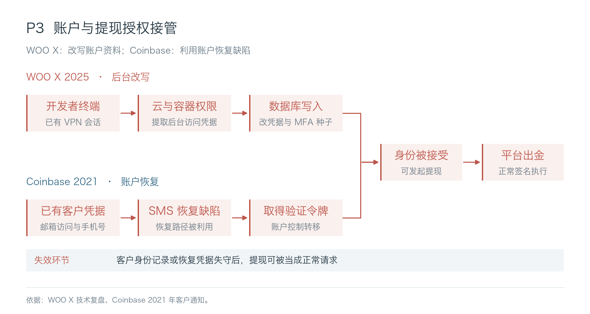

Coinbase 2021 年通知至少 6,000 名客户发生未授权转出。攻击者已掌握账户凭据、电话号码及邮箱访问，再利用 SMS 账户恢复缺陷取得验证令牌。

WOO X 的攻击者经开发者终端、已有 VPN 会话、云及容器环境进入后台，改写 9 个账户的邮箱、密码和二次验证种子，再发起提现。BigONE 的说明涉及生产环境、账户及风控逻辑被修改；Bitget 2026 年披露攻击者通过第三方安全产品漏洞取得内部高权限凭据，伪造提现指令。

合约钱包中的权限检查也可能被绕过。Parity 2017 年事件中，攻击者利用初始化缺陷改写钱包所有者及阈值，无须取得原所有者私钥。

### 2.4 交易与估值操纵

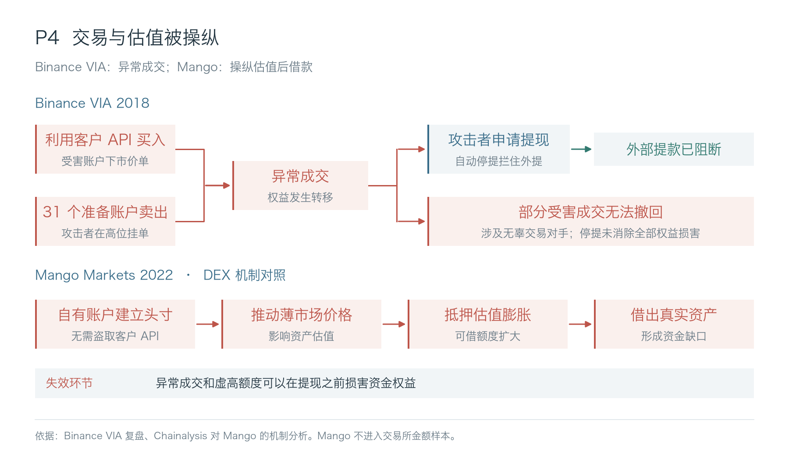

2018 年 Binance VIA 事件中，攻击者通过钓鱼取得用户凭据并创建 API，集中发出 VIA 市价买单，预先准备的 31 个账户在高位卖出。自动停提拦住了攻击者的外部提款，但部分受害买单与无辜交易者成交，公告明确表示无法撤回。

2022 年 3Commas 披露至少 10 万组 API 数据暴露，涉及存放在外部工具中的交易凭据。该数字统计 API 记录，并非受害者数量或资损金额。

Mango Markets 2022 年的 DEX 事件中，攻击者使用自己的账户建立头寸，推动薄流动性市场价格上升，将膨胀的账面收益作为抵押，借出真实资产。

### 2.5 错误入账与双花

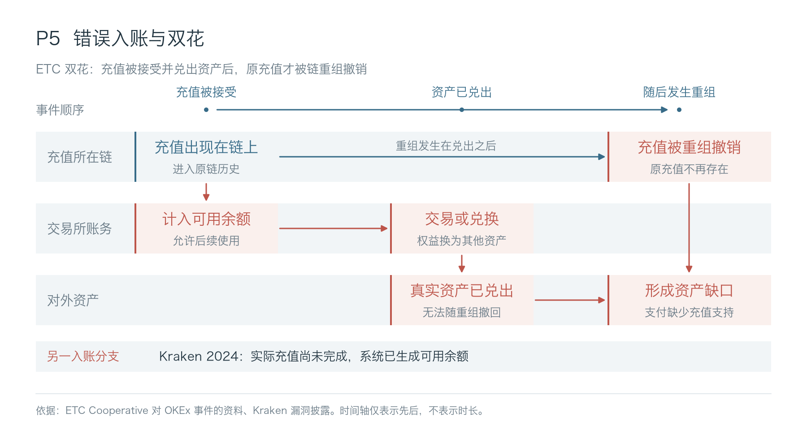

Kraken 2024 年披露的漏洞允许实际充值尚未完成时形成账户余额，研究人员据此提取约 300 万美元，随后引发授权范围争议。ETC 重组则涉及另一种失效：充值一度出现在链上，交易所已接受并兑出资产，之后充值在新链历史中被撤销；OKEx 2020 年相关双花损失约 560 万美元。

未完成或随后被撤销的充值被计为可用余额后，后续提现就可能转走没有真实充值支持的资产。入账时要核对收到的资产及数量、交易是否执行成功，并按对应链处理确认和重组。

### 2.6 诱骗客户转账或授权

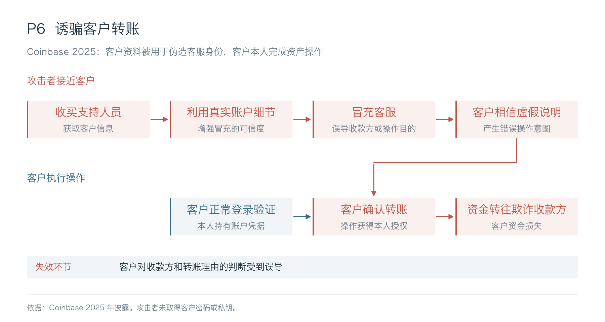

Coinbase 2025 年披露，攻击者收买部分海外支持人员，获取客户信息并用于冒充和社交工程；攻击者没有取得客户密码和私钥。能够准确说出账户资料，帮助攻击者建立了虚假的客服身份。

FBI 的欺诈通告记录了生成式 AI 在假身份、文本及合成音视频中的用途。用于冒充客服时，真实客户资料可以提供账户细节，合成内容则帮助伪造交流对象。

## 三、反复出现的防御短板

### 3.1 15 起事件对照

| 比较对象 | 攻击者控制的对象或利用的缺陷 | 处置结果与差异 |
| --- | --- | --- |
| Coinbase 2019、2023；WOO X 2025 | 员工凭据或终端访问；WOO X 继续取得生产写权限 | Coinbase 两案披露未损失客户资金；WOO X 的攻击继续进入后台，改写身份资料并发起提现 |
| Coincheck 2018；BitMart 2021 | 足够形成有效签名的私钥材料 | 已发生资产外流；攻击者可在平台外自行签名。Coincheck 披露了推定入侵过程，BitMart 的最初入口仍未知 |
| Gate.io 2018；DMM 2024；Bybit、Kiln 2025 | 修改提现脚本、供应商通信、前端资源或 API 返回的权限 | 恶意内容被用于构造资金操作。DMM 的请求操纵仍为调查判断；Bybit 和 Kiln 的恶意交易进一步改变链上控制；Gate.io 总损失未核定 |
| Coinbase 账户恢复 2021；支持人员事件 2025 | 前者取得恢复验证令牌；后者取得客户资料并冒充可信身份 | 前者由攻击者接管账户后转账；后者诱骗客户本人操作 |
| Binance VIA 2018；Binance 2019 | 被盗客户凭据、API 或其他验证信息被用于资金相关操作 | VIA 的外提被提前拦住，但部分受害成交不能撤回；2019 年告警发生在 7,000 BTC 转出之后 |
| Kraken 2024；OKEx / ETC 2020 | 使未完成或随后失效的充值成为可用余额 | 真实资产已经兑出，失效位置分别是入账逻辑和链上最终性；Kraken 事件涉及研究授权争议 |

这 15 案中，4 案涉及外部服务输入或通信，含 DMM 的可能链路；其中 3 案明确存在按页面、钱包或资产条件触发的恶意内容，2 案改变了链上执行逻辑或提款权限。另有 2 案披露攻击被阻断且客户资金未受影响，1 案拦住外提，但此前部分成交造成的损害仍然存在。同一事件可以同时具备上述特征，数量均按已披露信息统计。

### 3.2 多套检查共用同一份输入

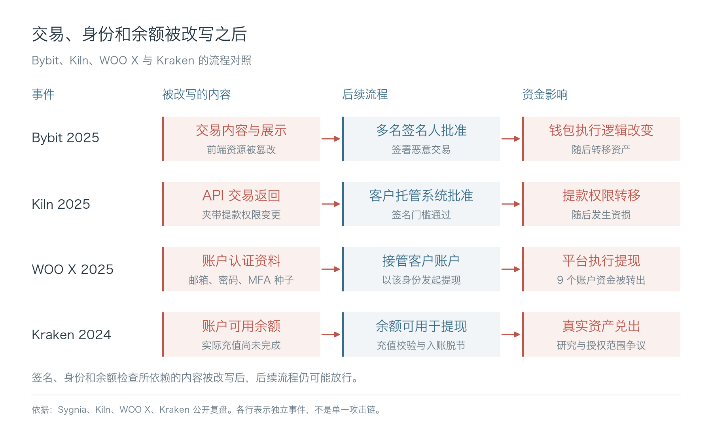

Bybit 和 Kiln 的签名流程批准了被改写的交易。WOO X 的攻击者先改写客户身份资料，再发起提现；Kraken 的入账漏洞则使尚未完成的充值形成可提现余额。这些攻击发生后，系统中的交易、身份或余额记录已不可信。核查时，要分别追到原始业务请求、账户资料变更记录和实际结算结果，确认后续批准依据是否被改动。

Bybit 与 Kiln 的交易由外部服务构造或展示，客户的签名流程依赖这些输出。供应商因此能够影响客户签下什么，即使它没有保管客户的全部签名材料。

BitMart 的两个钱包使用同一私钥，一次密钥泄露同时影响两个钱包。Bybit 的多名签名人查看同一份被篡改的交易展示，多个批准并没有形成相互独立的核对。

交易模拟给出指定状态下的预期执行结果。操作是否经过业务批准，还要回查原始请求和批准记录。交易构造方能够伪造批准记录，或与校验组件共用管理身份时，攻击者可能同时修改交易和检查依据。

GTIG 已记录恶意依赖和工作区配置被用于操纵 AI 编程助手的活动。助手读取的代码、说明和工具返回可能含有恶意指令；它拥有发布或生产访问权限时，受诱导执行的操作就可能影响交易系统。

### 3.3 链上权限与后续入金

Bybit 的执行逻辑变化与 Kiln 的提款权限变化，都发生在后续资产转移之前。两案都存在权限已经改变、资金尚未转出的阶段。

EIP-7702 允许普通账户通过授权设置执行委托。授权签名与外层交易签名不同，其他地址也可以提交这份授权。设置委托与调用委托代码可能在同一笔交易完成；交易执行失败，也不会回滚已经处理成功的委托。

只在广播环节禁止某类交易，会漏掉签名服务生成授权、攻击者从外部提交的路径。委托生效后，能否从外部转走资金取决于委托代码的权限检查，本方停提未必能阻止。

热钱包被接管后，自动补款、冷暖调拨和客户入金仍可能继续送入资产。可被转走的资金，取决于攻击权限持续多久、期间流入多少资金，以及攻击者能否修改限额。估算时还要扣除不同路径重复涉及的同一笔资产。

降低在线余额可以减少当时可被转走的资金，后续补款和调拨则需要单独限制。停止业务系统不会自动作废已经生成的签名，也不会自动撤销链上权限。

清除 EIP-7702 委托后，代币合约中的转账授权（allowance）仍按各自状态生效；私钥已经泄露时，攻击者还能重新签名。这些残留能力也可能威胁旧地址后续收到的资产。

### 3.4 交易、入账与授信风险

VIA 事件中，部分受害成交在外提被拦后仍无法撤回；Kraken 和 ETC 事件中，内部可用余额分别缺少已完成的充值、失去了最终有效的链上结算支持。Mango 则展示了虚高估值如何转成借款能力。

统一账户、现货兑换和抵押借贷会把这些风险带入其他产品。错误余额被允许换币，就可能从另一币种的提现通道兑出；虚高估值被接受为抵押，就可能借走真实资金。实际影响取决于平台允许哪些资产兑换和抵押。异常成交转移客户权益时，平台总账还可能保持平衡，仅靠资产对账也难以识别这类损害。

提现限制生效后，已经完成的成交和借款仍然存在，相关客户损失及信用风险需要继续处理。

### 3.5 按钱包和金额定向触发

Gate.io 的恶意脚本按提现页面、金额或余额触发；Bybit 的恶意前端筛选特定钱包；Kiln 的 API 针对相关提款权限下质押余额超过 15 万 SOL 的账户。

普通账户和小额操作可能始终得到正常响应。Kiln 的恶意逻辑直接改在运行中的服务里，检查仓库或镜像也可能漏掉实际返回给客户的交易。验证范围因此要包括目标钱包、资产规模和实际运行环境。

### 3.6 12 起事件的攻击归因

各案的攻击者归属来自执法调查、平台披露、研究机构分析或团伙认领，表中分别注明。工具和洗钱渠道可能被多个团伙共用，判断是否为同一攻击者，还要结合具体的入侵证据。

| 事件 | 攻击者及归属 | 证据性质与限制 |
| --- | --- | --- |
| Bitfinex 2016 | Ilya Lichtenstein；个人 | 美国司法部确认入侵及后续洗钱分工。 |
| Coinbase Firefox 双零日攻击 2019 | CRYPTO-3 / HYDSEVEN；国家归属：未知 | Coinbase 内部追踪标签与别名。 |
| DMM Bitcoin 2024 | TraderTraitor；朝鲜关联活动 | FBI、DC3 与日本警方联合归因；请求操纵为可能链路。 |
| Bybit 2025 | TraderTraitor；朝鲜关联活动 | FBI 归因。 |
| Binance 2026 | TraderTraitor；朝鲜关联活动 | FBI 归因；DevOps 终端至服务容器为平台初步调查判断，完整链路未知。 |
| WOO X 2025 | UNC4899 / UNC5565；平台认为朝鲜关联 | 平台判断；报告不同段落使用的 UNC 标签不一致。 |
| Bitget 2026 | 朝鲜关联活动；具体行动组：未知 | Chainalysis 研究判断。 |
| Nobitex 2025 | Gonjeshke Darande / Predatory Sparrow；国家归属：未知 | 团伙认领；Chainalysis 分析资产销毁行为。 |
| SwissBorg / Kiln 2025 | 未知 | 供应商披露。技术入侵路径已披露。 |
| Coinbase 支持人员事件 2025 | 未知 | 平台披露。人员收买和客户欺诈机制已披露。 |
| Kraken 入账漏洞 2024 | CertiK Skyfall 团队；安全研究团队 | 平台披露，CertiK 确认参与；漏洞利用范围存在争议。 |
| Coinbase SMS 账户恢复 2021 | 未知 | 客户通知。客户凭据最初取得途径：未知。 |

### 3.7 攻击者画像

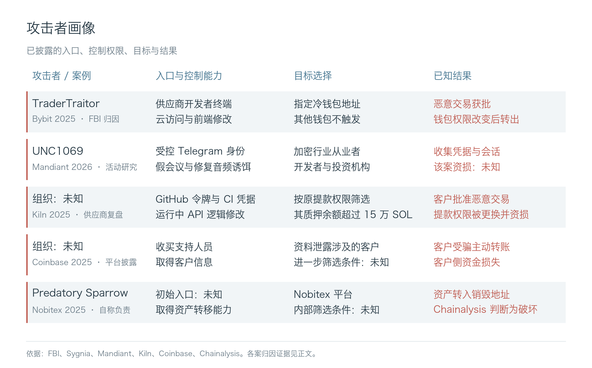

UNC1069 的画像来自行业威胁研究，不计入事件与金额样本。

### 3.8 攻击手法的演变

DMM 与 Bybit 都被归于 TraderTraitor。DMM 的请求操纵仍是调查判断，Bybit 的前端篡改已被确认。Kiln 的攻击者归属未知，但已确认 API 返回的交易被修改，影响了客户最终签署的内容。

开发者与基础设施工程师持有的令牌和会话，可能让攻击者进入代码仓库、发布系统或生产环境。针对签名人的攻击可以影响交易批准，针对支持人员的攻击则可能取得客户资料，用于后续冒充和诈骗。FBI 的加密行业通告记录了研究员工背景、并行接触多人，以及以招聘或投资建立关系的行为。

2018 年已经出现 AppleJeus 交易软件诱饵和 Gate.io 外部脚本攻击；近年的开发合作、供应商 API 与质押服务，又提供了接触人员和改变交易内容的机会。私钥盗窃、社工和供应链攻击一直并存。发布系统、运行中的 API 和客户签名流程，都已出现在公开入侵记录中。

Mandiant 对 UNC1069 的调查记录了完整的人员接触过程：攻击者利用受控 Telegram 身份建立联系，以假会议和“修复音频”诱饵感染终端，再收集凭据、浏览器资料和会话。报告记录了该组使用 AI 辅助侦察与工具开发；该次会议视频疑似深伪的描述来自受害者，未获独立取证确认。窃取的身份和会话还可能被用于接近受害者的联系人。

GTIG 还观察到，攻击者在取得云资源后，用不到六小时规划、构建并执行了一项 Agent 辅助的凭据收集行动。NCSC 对 2027 年的评估也预计，AI 会进一步提高已知漏洞利用的效率。

凭据收集加快，意味着同一终端上的云、代码和运维会话可能更快被利用。诱饵制作成本下降，也可能增加针对开发合作和客服交流的攻击尝试。对交易所而言，关键风险在于这些会话能否修改资金系统，以及后续检查能否拦住恶意操作。

## 四、事件响应复盘

### 4.1 响应时间与统计口径

TTD 记录明确初始失陷到发现的单案时间；MTTD 是同口径 TTD 的平均值。初始失陷时刻未知时，保留已知行为到发现的间隔，单独注明起点。TTC 从发现计到约定的遏制措施验证生效，注明限制了哪种操作、哪些系统和资产。清除后门、修复入口等根除工作另外记录。TTR 从明确起点计到约定的恢复状态；只有起止点、范围与精度可比的 TTR 才计算 MTTR。

12 案的公开材料提供了 7 项可用的时间数据：4 案可按公布的日期或时刻计算间隔，另 1 案只有平台自报的缓解时长上限。各项数据的起止点与恢复范围不同，无法合并计算 MTTR。

| 事件及指标 | 起点 → 终点 | 结果 | 指标口径 |
| --- | --- | ---: | --- |
| Coincheck 2018：已披露转出跨度 | 1 月 26 日 00:02 → 08:26，日本时间 | 504 分钟 | 资金转出跨度，发现点未知 |
| Kraken 2024：发现至缓解 | 平台发现问题 → 完成缓解，绝对时刻未披露 | 少于 60 分钟 | 平台自报时长上限，非技术恢复或追回时间 |
| Bybit 2025：上游最早已知入侵至资金攻击 | 2 月 4 日 → 2 月 21 日 | 17 个日历日 | Safe 侧起点，不等于 Bybit 可见的检测窗口 |
| WOO X 2025：后门落地至资损日 | 7 月 8 日 → 7 月 24 日 | 16 个日历日 | 已知节点间隔，非完整驻留时间 |
| WOO X 2025：首次提现所在节点至发现并遏制 | 7 月 24 日 13:50 → 15:40，UTC+8 | 110 分钟 | 公告合并节点，无法拆成独立检测与遏制时长 |
| Kiln 2025：恶意权限签署至发现 | 8 月 31 日 → 9 月 8 日 | 8 个日历日 | 控制权变更到供应商发现异常 |
| Kiln 2025：发现至恢复状态公告 | 9 月 8 日 → 10 月 7 日 | 29 个日历日 | 各服务实际恢复时刻：未知 |

所有日期均为各案年份；仅披露日期的间隔以日历日表示。

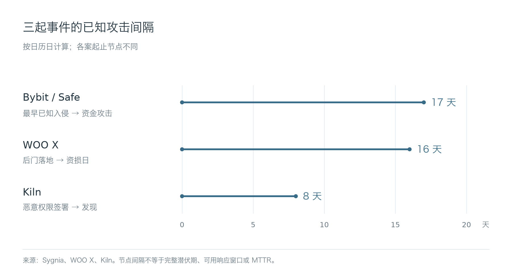

### 4.2 外部转出前的阻断

**Binance VIA，2018。** 最早钓鱼接触约在 1 月，实际账户失陷时刻未知。3 月 7 日 14:58—14:59 UTC 出现异常成交，风险系统在这一阶段自动停提，早于攻击者的提现请求。公告称检查后恢复提现，但没有准确停提和恢复时刻。外部提款被拦住，部分与无辜对手成交的受害交易无法撤回；两分钟描述的是成交时段，不能用作 MTTR。

**Coinbase Firefox 双零日，2019。** 5 月 30 日已有定向邮件接触，6 月 17 日 06:31 投递利用链接，原文未标时区，主机实际失陷时刻也未精确给出。平台称数小时内发现并阻断，没有客户资金损失，服务恢复时间未知。

**Coinbase 员工社工，2023。** 2 月 5 日员工密码遭钓鱼，MFA 拦住直接登录。攻击者约 20 分钟后电话冒充 IT，诱导员工操作工作站，导致有限通讯录信息暴露，客户资金及信息未受影响。平台称 CSIRT 在攻击发生后的前 10 分钟内介入，但未说明这一计时与电话阶段的关系，精确 TTD 未知。平台通过联络员工、暂停访问进行处置；清理被描述为较快，准确恢复时刻未知。

### 4.3 资金转出后的处置

**Coincheck，2018。** 员工终端入侵日期未公开；官方 FAQ 确认 NEM 在 1 月 26 日 00:02—08:26 日本时间非法转出。发现和有效遏制时刻未知，504 分钟为已披露的转出跨度。3 月 12 日是赔付完成日期，技术修复终点仍未知。

**Binance，2019。** 最初入侵时间未披露。5 月 7 日 17:15:24 UTC，7,000 BTC 转出；公告称交易执行后报警，随后立即停提，但没有可复算的秒级延迟，技术恢复完成时刻也未知。该次告警晚于首笔链上损失，与 VIA 事件中外提之前触发的控制位置不同。

**Coinbase SMS 账户恢复，2021。** 3 月至 5 月 20 日期间，至少 6,000 名客户发生未授权转出，逐户最初失陷时刻未知。攻击者通过恢复流程取得账户控制权。平台获知后更新恢复协议，发现、修复和完整恢复的准确时间均未披露。

**Kraken 入账漏洞，2024。** 研究人员首次利用时刻未知，报告前已有约 300 万美元争议提款。平台称发现后不到一小时完成缓解，并披露已修复；报告、缓解和完整恢复的准确时刻未知。这项时长从获知问题起算，没有覆盖此前的利用阶段，也没有包含返款或服务恢复。

**WOO X，2025。** 7 月 8 日开发者终端后门落地；7 月 24 日 13:50 UTC+8 的时间线节点包含重新进入后门、改写账户资料和首次未授权提现，15:40 节点合并披露发现与遏制，处置包括停提及恢复账户信息。两个节点相隔 110 分钟；首次提现的准确时刻、独立的发现与遏制时刻均未知。平台还披露随后三周调查整改及环境迁移，没有统一完成时刻。该轮处置发生在资金开始外流之后。

### 4.4 供应商入侵与链上权限变更

**DMM Bitcoin，2024。** 3 月下旬，供应商员工收到招聘诱饵；5 月中旬后出现会话信息滥用，5 月 31 日发生资金转出。联合调查认为攻击者很可能操纵合法请求，但没有披露发现攻击、遏制生效和技术恢复的准确时间。入侵从供应商延伸到交易所，现有时间线无法用于计算交易所自身的检测时长。

**Bybit，2025。** Safe 开发者终端最早已知恶意活动在 2 月 4 日，2 月 21 日发生恶意交易及资产转出，间隔 17 个日历日。准确发现、遏制和技术恢复时刻未知。攻击者在恶意交易后两分钟移除前端代码、清理痕迹。该次资金控制未能在钱包执行逻辑改变前阻断恶意交易。

**SwissBorg / Kiln，2025。** GitHub 令牌最初失守时刻未公开；8 月 31 日客户签署恶意提款权限交易，9 月 8 日供应商发现未经授权活动，相隔 8 个日历日。Kiln 称随即遏制并停用可能受影响服务，未给准确处置时间；10 月 7 日公告称所列服务已可用，距发现异常 29 日，各服务实际恢复时刻未知。资金控制权在异常发现前已经改变，API 停用本身不会撤销这项链上权限。

**Binance，2026。** FBI 将资金事件日期记为 10 月 29 日。平台初步披露 DevOps 终端可能失陷、服务容器被访问及未授权提现，后续发现其他入侵点；终端最初失陷及精确发现时刻未知。平台称已暂停提现并撤销受影响地址的授权，未给出可复算的生效时刻。11 月 1 日公告列出分阶段恢复安排和资产补充进度，各项服务实际恢复及完整根除时刻仍未知。

### 4.5 处置效果对照

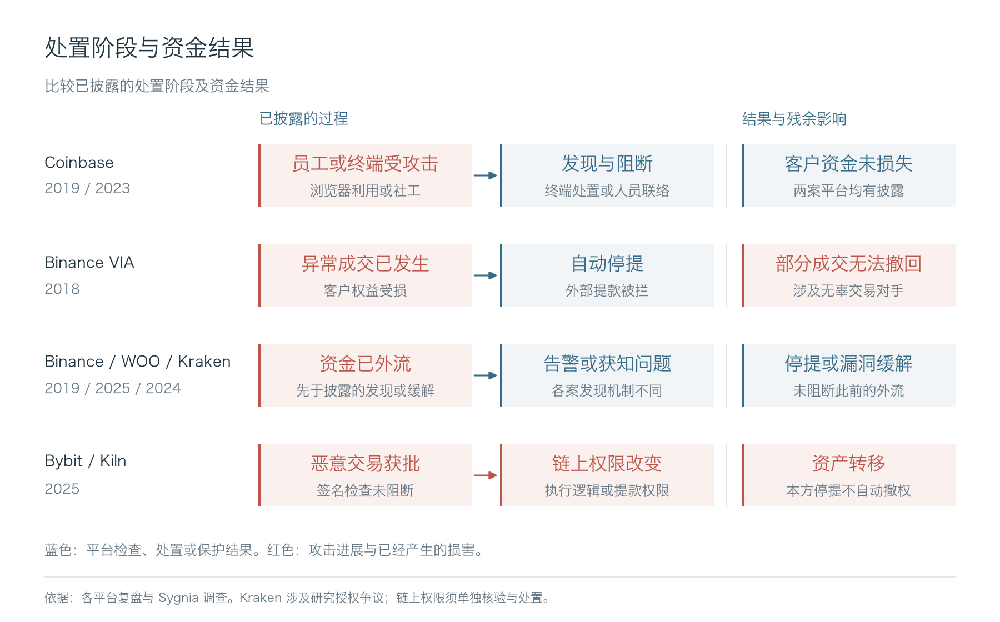

Bybit 的 17 天和 WOO X 的 16 天，包含不同环境和不同阶段的活动。部分早期证据位于供应商，后续攻击还依赖签名、调拨或特定账户状态。交易所发现异常后，仍需定位受影响业务、取得处置授权并执行限制。链上权限未撤销、有效签名仍在攻击者手中时，停提后也可能继续转出资产。

### 4.6 恢复后的残留风险

CoinDCX 2026 年披露，前一年事件中受影响的旧钱包地址仍然收到用户充值。平台先为用户入账，再通过另一项服务归集资金；归集失效后，旧地址积累资产，最终产生约 1,599 万 USDT 损失。第二次攻击取得资产控制权的完整过程未在公告中披露。

地址从产品界面移除后，用户仍可能向保存过的地址充值。平台继续识别这些充值并为客户记账时，还要确认对应资产能够转入受控钱包；归集故障会让资金持续积累在旧地址。

2016 年 ShapeShift 的复盘已经记录过恢复环境再次失守：内部人员协助与终端恶意程序，使攻击者在重建过程中继续接近新的访问凭据。更换服务器和密钥没有同时消除获取新凭据的路径。

2026 年 Zilliqa 披露 Ledger 应用在旧交易签名流程中的随机数处理缺陷，受影响私钥可从历史公开签名中恢复；KuCoin 的冷钱包异常促成了此次调查。该链于 7 月 20 日禁用受影响的旧交易类型。应用修补无法消除历史签名对旧密钥的暴露，受影响密钥仍需退役。

### 4.7 资产兑换、冻结与销毁

Liquid 2021 年事件中，Elliptic 估算约 9,700 万美元资产被盗，其中约 4,500 万美元以太坊代币被转换成 ETH。这种转换降低了发行方冻结代币的机会。币安此次事件也同时出现了稳定币冻结与其他资产转移。

原生资产通常没有发行方可调用的冻结接口。被盗资产兑换成这类资产后，原代币发行方就无法通过冻结原代币阻止后续转移。已经冻结的资产，还需经过相应程序才能返还。

Nobitex 2025 年事件由 Predatory Sparrow 自称负责，Chainalysis 判断相关资产被转入无法正常支配的销毁地址，动机更接近政治破坏。资产一旦被销毁，拦截后续兑换或变现已无法追回。

## 五、交易所防御建设的优先级

### 5.1 高风险生产权限

已泄露的凭据、正在被利用的漏洞和已确认的未授权生产访问，要立即限制和处置。长期建设的先后顺序，取决于攻击者能接触哪些资产、还有哪些检查能拦住攻击，以及改造会影响哪些业务。

WOO X 的已有会话和后台权限被用于改写账户资料；Kiln 的代码托管令牌与流水线凭据被用于进入生产环境、修改交易返回。能发布交易代码、重置客户身份、读取密钥或放宽资金规则的人员和服务账户，是基础安全的重点。终端、身份、云和运行时防护保护这些入口；资金层面的额度、授权和补款限制，用于减少入口失守后的损失。

研发日常要运行外部代码、调试生产和接入供应商。AI 编程助手与生产凭据处于同一环境时，恶意依赖、工作区配置或工具调用可能暴露这些凭据。隔离实验与生产访问、缩短授权时间、减少长期有效的秘密凭据，会增加研发平台和运维成本。验证应记录身份失陷后能进入哪些系统，并分别测试正常登录、现有会话和账户恢复。

同一身份能够同时修改资金请求和校验规则时，拆分这两项权限应优先处理。已有独立检查能拦住恶意请求的系统，则重点检查发现延迟、仍可被转走的资产和恢复后遗留的访问权限。预算安排以这些验证结果为依据。

### 5.2 钱包、风控与账务

Bybit 与 Kiln 的恶意交易通过了签名环节；VIA 的客户损害发生在成交阶段；Kraken 与 ETC 的资产缺口涉及可用余额的形成。交易核验、成交风控和入账检查，分别涉及钱包、业务与账务系统。平台外使用失窃私钥的交易，也不会经过本方应用的出金风控。

| 资金风险 | 建设重点 | 业务影响与适用范围 |
| --- | --- | --- |
| 密钥或链上支配权失守 | 保护密钥全生命周期；减少单项签名能力可控制的资产；独立约束补款和授权 | 降低在线余额增加调拨频率；应用限额仅约束本方流程，已被外部取得的签名能力须另外处置 |
| 恶意交易获得有效签名 | 签名前将最终字节及预期权限变化与原始业务请求核对；分开管理交易构造与校验权限 | 解析覆盖不足会限制新链和新业务接入；高风险、无法解释的操作需要受限处理，影响上线和资金周转 |
| 账户恢复或后台写入改变授权身份 | 约束恢复验证、管理写入与凭据重置；把异常身份变更关联到出金 | 复核影响客户恢复效率；缩小限制范围需要可靠的账户与业务映射 |
| 客户受骗后主动转账或授权 | 限制客户资料滥用；关联报案、异常操作与反欺诈核验 | 增加核验会打扰正常客户；客户已在平台外操作的自托管资产，平台没有统一停提开关 |
| 异常成交、估值或结算产生可兑现权益 | 在成交、授信、入账各自设置约束；追踪权益进入其他产品的过程 | 限开仓、限借款、限出金分别影响交易和流动性；停止全部清算还可能扩大存量持仓风险 |

这些检查依赖链节点、价格和身份数据，也受规则发布、紧急放行和出金编排控制。同一管理身份同时掌握数据源、规则和放行权限时，几道检查可能被一起改掉。签名前模拟得到的是特定状态下的预期结果，广播前仍需检查放行条件，链上执行后再核对实际资产与权限变化。风控超时后，新增借款可以暂停；存量仓位仍有清算风险，在途交易和已生成的签名则要继续核查执行状态。

限额验证还要覆盖并发执行。多个请求读取同一份剩余额度、分别获批后，合计支出可能超限；已签未确认交易仍可能占用额度，超时重试也可能重复支出。资金上限的验证要追到额度预留、在途交易和最终结算，不能停在逐笔放行结果。

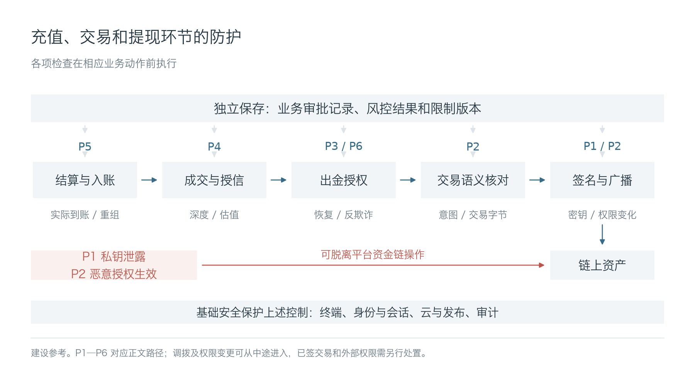

### 5.3 业务接入与部门协作

统一账户、借贷、质押和多链接入，会让一笔余额用于更多业务。资金团队负责周转，研发负责余额与状态变更，钱包负责签名，风控负责账户、交易与信用限制。允许某类余额参与抵押，会同时影响账务、借款额度和可贷资金。评审因此要覆盖从余额变化到最终提现的完整过程。

安全团队按风险安排专业职能参与：应用安全与研发审查授权设计、代码和异常状态处理；基础设施与身份安全检查生产访问；钱包与合约安全核查签名和链上权限，数据安全核查敏感资料访问。安全运营负责检测与响应，红队验证跨系统攻击路径。GRC跟踪控制执行和风险例外，未解决风险交有权的业务负责人决定。各系统团队继续负责控制实现、修复和日常维护。

前端、交易构造 API 和有生产权限的安全产品，都可能影响资金审批。供应商审查应检查它实际能修改什么，范围包括这些非托管服务。DMM 的监管检查记录了开发、运维与安全管理权限集中、自我监督及外部钱包评价不足。

供应商接入需要付出日志获取、交易验证、访问撤销和退出迁移的成本。拿不到服务端日志，交易所仍可检查实际返回的交易，但难以还原上游入侵过程。限制供应商可接触的资产和操作，会相应减少可用功能。

人员离职后，服务令牌、发布账户和曾经放宽的权限可能仍在使用。只注销个人账号，会漏掉这些访问。系统负责人、IT 和身份管理团队需要核对用途、负责人及撤销影响，并保留交接记录。后续接手者才能确认哪些权限仍支撑生产，哪些已经可以停用。

安全运营发现生产身份失陷后，需要查清它影响了哪些客户账户和出金请求；风控发出的限制，也要落实到钱包实际处理的签名任务。合批、拆单和重试可能改变执行请求，出金编排需保留它们与原业务单及放行版本的对应关系。研发、风控和钱包共同验证重新排队后的任务仍受限制。OWASP 的交易授权原则要求内容变化后重新授权，并在执行前设置最终检查。

确认身份被接管后，隔离访问与限制相关资金业务可以同时进行。待核实信号达到预先约定的高风险条件时，也可以先限制特定账户、请求或业务，再并行调查。临时限制需有复核期限和解除权限，超时未查清则升级处置。停提、限借款和停清算的代价不同，相应业务负责人应事先约定授权范围。客服报案、异常查询和资金行为也可反向触发后台入侵排查。处置记录区分已收到、已执行和已验证生效；系统已受攻击者控制时，结果还需独立渠道复核。

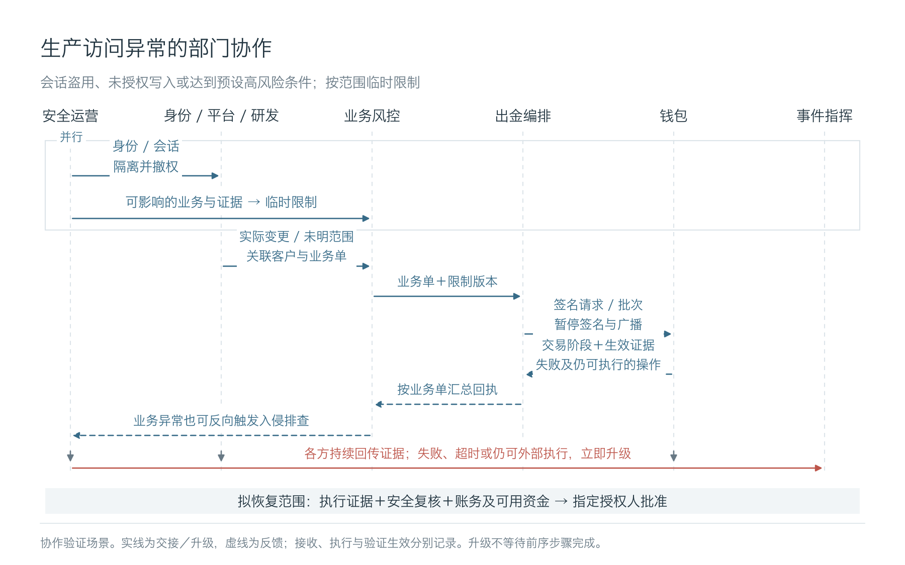

### 5.4 安全团队的 Agent 化

攻击者沿终端、生产权限和资金流程继续推进，防守侧的调查、处置、修复和复测也需要连续运转。Agent 可以承担已获授权的查询、分析和执行，工程师的工作随之转向构建这些能力、监督运行质量，并处理疑难判断。跨部门等待、重复补背景和重新取证，都会消耗发现异常后本可用于止损的时间。

以安全运营处理生产身份失陷为例，实时分析引擎收到信号后，可以并行查询会话、云权限、部署和数据库变更，再关联受影响的账户及出金请求。各项调查共享同一份案件状态，区分已确认修改、可访问范围和未查明项。达到预设条件后，执行层限制相关会话和出金任务，并从身份平台、账务和链上检查实际结果。专家在统一工作台追问证据、补充业务背景，由有权人员审批超出预授权的动作；持续分析由事件驱动，不必等待人逐条发起会话。现有安全产品通过接口提供数据和执行能力，案件与证据由交易所自己保存。

钱包、研发、风控和安全人员熟悉生产身份的权限、质押交易允许的操作，以及旧地址的充值安排。调查时，把这些业务背景与日志记录对应，才能判断一次访问或交易会影响哪些资产。团队可以将确认过的判断整理成 Agent 可调用的 Skill、系统强制执行的策略和有已知答案的评估用例，并保留负责人、版本及适用范围。接手者据此继续维护；更换模型或供应商时，也能重跑同一批案例检验能力。

应用安全在需求和设计阶段明确授权与校验要求，再通过代码审计和业务逻辑测试检查实现。调查确认交易构造方能够伪造业务批准后，研发修复就要补上批准来源校验，并加入伪造请求的回归测试。Agent 可以协助审查同类代码、生成补丁和补充测试，应用安全复核修复结果，发布仍受独立门禁约束。钱包代码、身份恢复规则或出金编排发生变化时，相关攻击用例随之重跑。

红队的工作也会延伸到持续验证。历史攻击链可以在获批范围内自动回放，红队继续寻找既有用例之外的组合路径，检验业务方和建设方没有列出的风险。生成和复核 Agent 共用模型、上下文及判断规则时，仍可能一起漏掉问题。验证要保留独立的攻击假设、测试权限和取证渠道，直接检查资金、权限及业务状态。恶意工单、仓库内容和供应商返回，也要用于测试 Agent 会不会被诱导越权、修改安全策略或污染评估集。

安全架构与 Agent 工程人员维护工具接口、策略和执行边界，各专业职能维护本领域的分析和验证任务。GRC可以用Agent关联控制要求、实际执行记录和未解决问题，例外由有权的负责人审批，并保留期限和复核记录。安全BP负责协调业务，重大风险决定仍由业务授权人作出。真实事件的定论经取证和专业复核后再进入评估集，避免把 Agent 自己的初判直接回填成评估用例的正确答案。

投入可以先从一条资金业务链开始。通用模型和运行时复用成熟生态，交易所持续积累自己的业务上下文、处置策略、Skill、评估集与证据。先用历史事件回放和影子运行观察错误放行、误限制及人工接管，再按场景扩大执行权限；对已知紧急风险，仍按预授权策略及时阻断。效果看异常多久被定位、限制多久真正生效、修复后能否再次被绕过，以及新变更多久完成复测。专家整理经验、维护评估和纠正错误结论，也要计入建设投入。

恢复业务前，先验证待恢复系统与尚未完成调查的系统之间，访问、发布和资金通道已经受限。安全与技术团队复查旧会话和服务凭据，钱包检查链上权限，资金和账务团队核对资产及在途交易。多个系统共用的管理或发布权限仍可被利用时，相关业务继续受限。已知损失可以继续追偿，无法解释的差异则应限制相关业务恢复。

分批恢复可以控制重新开放的业务和资金规模。验证仍要覆盖高价值钱包和定向触发条件，并处理旧地址后续收款、已签交易及历史授权。监测失效或异常重现时，要能再次暂停相关业务；已广播交易无法保证回滚。

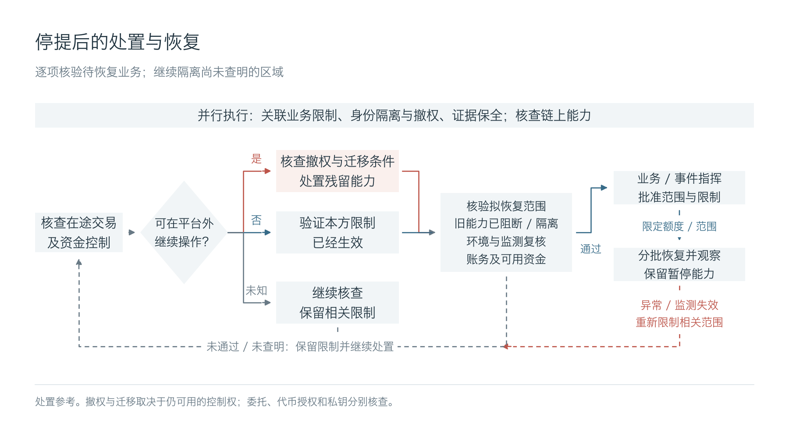

具体的责任分工和验收要求，见[防御建设与验收矩阵](defense-matrix.md)。

### 5.5 结语

共用签名材料的钱包会同时受到一次密钥泄露的影响。交易展示被篡改后，多名签名人也可能批准同一笔恶意交易。客户身份被改写或余额被虚增后，后续系统若只核对当前账户记录，仍可能放行提现。平台停提后，攻击者仍可能从外部转走其控制地址中的资产，包括此后收到的充值。

攻击侧的自动化可能加快凭据收集和后续利用。防守侧也要缩短调查、限制、修复和复测之间的等待，把每次事件确认过的判断留在系统里。Agent 获得的工具权限、它读取的内容，以及用于评价它的证据和用例，都属于这套防御的保护范围。

预算有限时，优先处理能够修改资金指令、客户身份和可用余额的权限，并让钱包、交易风控和账务各自保留拦截能力。验证结果应说明攻击者还能接触多少资产、异常余额是否仍可使用、处置是否生效，以及恢复后旧凭据和授权是否已经失效。新业务上线、供应商接入和权限变更后，这些结论都要重新核对。

---

**参考资料**

**事件通告、调查与复盘**

- Binance 2026：[初步调查通告](https://www.binance.com/en/support/announcement/detail/c5a8729a97ac486d963784d96c5642d7)、[后续更新](https://www.binance.com/en-TR/support/announcement/detail/d3306d9dca5243548c813b605e1d1751)、[FBI 归因通告](https://www.fbi.gov/investigate/cyber/alerts/2026/north-korea-responsible-for-6-billion-binance-attack)、[恢复安排](https://www.binance.com/en/support/announcement/detail/73911fb819b240f88b88256bdd318eda)、[Elliptic 链上分析](https://www.elliptic.co/insights/binance-largest-hack-in-history/)。
- Binance VIA 2018、盗币事件 2019：[VIA 事件复盘](https://www.binance.com/en/support/announcement/detail/360001547431)、[2019 年事件通告](https://www.binance.com/en-AU/support/announcement/detail/360028031711)。
- Bybit 2025：[Sygnia 技术调查](https://www.sygnia.co/blog/sygnia-investigation-bybit-hack/)、[FBI 归因通告](https://www.ic3.gov/PSA/2025/PSA250226)。
- DMM Bitcoin 2024：[FBI、DC3 与日本警方联合调查](https://www.fbi.gov/news/press-releases/fbi-dc3-and-npa-identification-of-north-korean-cyber-actors-tracked-as-tradertraitor-responsible-for-theft-of-308-million-from-bitcoindmmcom)、[关东财务局检查及行政处分](https://lfb.mof.go.jp/kantou/kinyuu/pagekthp0270000030.html)。
- SwissBorg / Kiln 2025：[Kiln 技术复盘与服务恢复说明](https://www.kiln.fi/post/re-enablement-of-kiln-services-and-security-incident-information)。
- WOO X 2025：[平台技术复盘](https://woox.io/blog/july-24th-security-incident-post-mortem)。
- Coincheck 2018：[官方调查说明与 FAQ](https://coincheck.com/info/faq_nem)。
- BitMart 2021：[安全事件更新](https://www.bitmart.com/en-US/support/articles/7922665245339/7923672421147/4411998987419)。
- BigONE：[技术说明](https://bigoneeurasia.ladesk.com/275817-Temporary-Platform-Maintenance)。
- Bitget 2026：[平台调查说明](https://www.bitget.com/academy/bitget-security-incident-what-happened-timeline-impact-response)、[Chainalysis 分析](https://www.chainalysis.com/blog/387m-bitget-theft-2026/)。
- Coinbase Firefox 攻击 2019、员工社工 2023：[Firefox 双零日复盘](https://www.coinbase.com/blog/responding-to-firefox-0-days-in-the-wild)、[员工社会工程复盘](https://www.coinbase.com/en-ca/blog/social-engineering-a-coinbase-case-study)。
- Coinbase 账户恢复 2021、支持人员事件 2025：[2021 年客户通知](https://oag.ca.gov/system/files/09-24-2021%20Customer%20Notification.pdf)、[2025 年平台披露](https://www.coinbase.com/en-nl/blog/protecting-our-customers-standing-up-to-extortionists)、[SEC 8-K 文件](https://www.sec.gov/Archives/edgar/data/1679788/000167978825000094/coin-20250514.htm)。
- Kraken 2024：[平台漏洞披露](https://blog.kraken.com/product/security/kraken-bug-bounty-program-patches-isolated-bug)、[CertiK 声明](https://www.certik.com/blog/certik-statement-on-kraken-vulnerability)。
- OKEx / ETC 2020：[ETC Cooperative 资料](https://etccooperative.org/ETC-Coop-Board-Package-August-2020.pdf)。
- 3Commas 2022：[API 数据披露通告](https://3commas.io/blog/notice-on-api-data-disclosure-incident)、[事件 FAQ](https://3commas.io/blog/api-security-incident-faq)。
- Bitfinex 2016：[美国司法部案件说明](https://www.justice.gov/archives/opa/pr/bitfinex-hacker-sentenced-money-laundering-conspiracy-involving-billions-stolen)。
- Nobitex 2025：[Chainalysis 分析](https://www.chainalysis.com/blog/nobitex-iranian-exchange-exploit-june-2025/)。
- CoinDCX 2026：[旧钱包地址事件通告](https://coindcx.com/blog/coindcx-news/on-chain-wallet-activity-update-21-oct-2026)。
- ShapeShift 2016：[ShapeShift / Ledger Labs 复盘存档](https://postmortem.io/incidents/shapeshift--2016-04-19--cyberattack-postmortem/)。
- Zilliqa 2026：[Ledger 签名应用事件复盘](https://www.zilliqa.com/ledger-incident/post-mortem/)。
- Liquid 2021：[Elliptic 资金分析](https://www.elliptic.co/insights/liquid-exchange-hacked-94-million-stolen/)。
- 外部机制对照：[OpenZeppelin：Parity 多签钱包事件](https://www.openzeppelin.com/news/on-the-parity-wallet-multisig-hack-405a8c12e8f7)、[Chainalysis：Mango 与价格操纵机制](https://www.chainalysis.com/blog/oracle-manipulation-attacks-rising/)。

**威胁研究与技术规范**

- 人员接触与社会工程：[FBI 加密行业定向社工通告](https://www.ic3.gov/PSA/2024/PSA240903)、[FBI 生成式 AI 欺诈通告](https://www.ic3.gov/psa/2024/psa241203)、[Mandiant UNC1069 调查](https://cloud.google.com/blog/topics/threat-intelligence/unc1069-targets-cryptocurrency-ai-social-engineering?linkId=49659601)。
- 攻击工具与活动演进：[Kaspersky AppleJeus 调查](https://www.kaspersky.co.uk/blog/lazarus-crypto-exchange-attack/14314/)、[TraderTraitor 联合通告](https://www.ic3.gov/CSA/2022/220418.pdf)、[GTIG AI 威胁报告](https://cloud.google.com/blog/topics/threat-intelligence/from-prompting-to-autonomy-the-evolution-of-adversarial-ai)、[NCSC 至 2027 年的 AI 威胁评估](https://www.ncsc.gov.uk/report/impact-ai-cyber-threat-now-2027)。
- 账户授权与交易控制：[EIP-7702 规范](https://eips.ethereum.org/EIPS/eip-7702)、[ERC-20 代币授权规范](https://eips.ethereum.org/EIPS/eip-20)、[OWASP 交易授权指南](https://cheatsheetseries.owasp.org/cheatsheets/Transaction_Authorization_Cheat_Sheet.html)、[OWASP 业务逻辑安全指南](https://cheatsheetseries.owasp.org/cheatsheets/Business_Logic_Security_Cheat_Sheet.html)。
- 身份与会话：[NIST 认证要求](https://pages.nist.gov/800-63-4/sp800-63b/authenticators/)、[NIST 会话管理要求](https://pages.nist.gov/800-63-4/sp800-63b/session/)。
